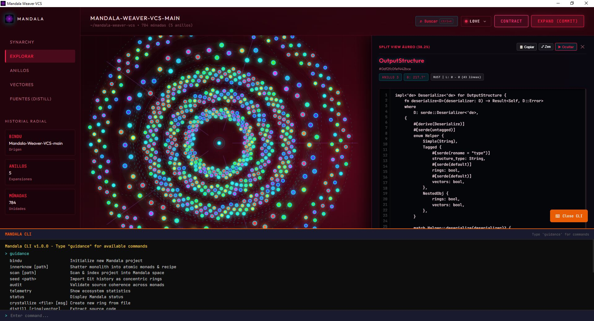
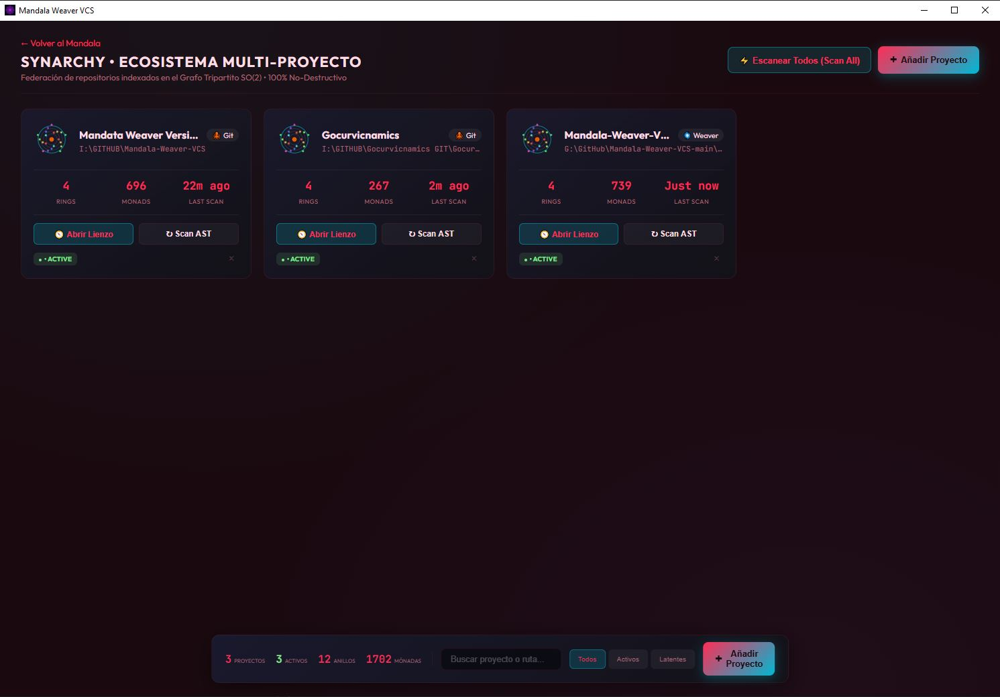
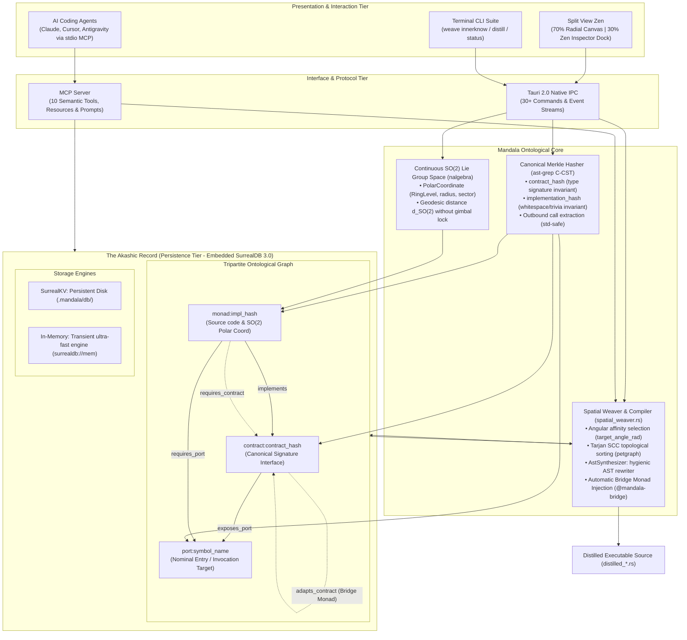

# Mandala Weaver: Versions Cooperation System
> **The Circular Time of Software.** A Synarchic, Spatial, and Semantic Code Orchestrator.

Mandala Weaver is the exact execution of the Golden Thread Engine instantiated in software architecture. It embraces a **Radial Version Space** where code is organized in living, circular geometry. Software emanates as pure, distilled logic units from an immutable center (the **Bindu**) and expands through concentric rings of evolution.

This topology enables non-linear code orchestration: the Architect selects precise spatial coordinates across various rings and vectors, weaving them into a harmonious, executable reality. The result is the **Distillation** of a unique Source—an infinite spiral of innovation where code expands outward with mathematical purity and structural harmony.

## Main UI



## Projects UI


---

## Logo


---

## 🌟 Propuesta de Valor (Value Proposition)

Mandala Weaver VCS fundamenta el desarrollo, navegación y síntesis del software sobre principios de geometría radial, análisis sintáctico profundo y persistencia en grafo. Sus fortalezas y capacidades distintivas son:

### 1. Granularidad Atómica y Pureza Semántica (Mónadas AST)
- **Aislamiento de Lógica Pura:** El sistema descompone el código fuente en unidades atómicas funcionales (funciones, estructuras, enumeraciones, traits, métodos) mediante análisis sintáctico profundo con [`ast-grep`](https://ast-grep.github.io/).
- **Invarianza Estilística:** Variaciones cosméticas de espaciado, formateo, comentarios o indentación son transparentes. La identidad de cada Mónada está ligada a su verdadera estructura sintáctica, garantizando un registro limpio y libre de ruido.

### 2. Sinestesia Cromática Inmediata (blake3 $\to$ HSL)
- **Frecuencia Visual Determinista:** Cada Mónada proyecta su hash criptográfico semántico (`blake3`) directamente al espacio de color HSL (Hue, Saturation, Lightness).
- **Validación Cognitiva Instantánea:** La percepción humana valida la estabilidad del código en microsegundos: si la lógica se mantiene invariante, su color permanece matemáticamente idéntico; si la lógica muta, su frecuencia cromática se desplaza de forma visible.

### 3. Topología Espacial Radial y Tiempo Circular ($r, \theta$)
- **Geometría Viviente del Software:** Los dominios funcionales (Núcleo, Interfaz, E/S, Datos, Red) se proyectan como Ángulos ($\theta$), mientras que las iteraciones y grados de madurez se expanden hacia afuera como Radios ($r$).
- **Tiempo Acumulativo No Destructivo:** La historia del código reside intacta en los anillos concéntricos interiores. El pasado no desaparece ni se degrada: permanece accesible, analizable y reutilizable en cualquier momento para alimentar nuevas creaciones.

### 4. Destilación Declarativa y Ensamblado Modular (Manifiestos YAML)
- **Composición de Fuentes a la Carta:** Posibilidad de compilar ejecutables y árboles de código seleccionando coordenadas y rangos específicos de Mónadas a lo largo de diversos anillos y vectores.
- **Recetas de Ensamblaje Reproducibles:** Manifiestos declarativos YAML que gestionan selección por rangos, exclusión selectiva, sustitución de variables y adaptadores semánticos automáticos para enlazar componentes entre anillos.

### 5. Simbiosis Nativa con Inteligencia Artificial (Model Context Protocol - MCP)
- **Servidor MCP de Primera Clase:** Servidor integrado (`weave mcp`) sobre `stdio` / JSON-RPC con 10 herramientas semánticas y recursos en vivo (`mandala://topology`, `mandala://rings`).
- **Comprensión Holística para Modelos:** Permite a agentes autónomos (Claude, Cursor, Antigravity, Cline) consultar topología, inspeccionar árboles de sintaxis, trazar linajes evolutivos y destilar código sin sobrecargar su ventana de contexto.

### 6. Registro Akáshico en Grafo Local y Robusto (SurrealDB + SurrealKV)
- **Memoria Histórica Embebida:** Base de datos de grafos embebida con almacenamiento persistente en disco en `.mandala/db/` (motor SurrealKV) y modo en memoria ultrarrápido para entornos de prueba.
- **Trazabilidad Evolutiva Completa:** Mapeo de relaciones (`evolves_to`), indexación compuesta multidimensional, inserciones masivas en lote (`insert_batch`) y recuperación paginada de alto rendimiento para miles de nodos.

### 7. Escaneo Automático y Registro de Ecosistemas (Synarchy)
- **Flujo Dual de Ingesta:**
  - **🌀 Mandala Scan (Nativo):** Escaneo directo y políglota de árboles de archivos (soporte para más de 30 formatos: `rs, ts, tsx, js, jsx, py, go, java, c, cpp, cs, html, css, scss, vue, svelte, astro, json, yaml, md`). Opera de forma independiente sobre cualquier carpeta **sin requerir Git**, sintetizando automáticamente Mónadas de tipo `Module` para archivos estructurales y asegurando que ningún proyecto quede con 0 nodos.
  - **🐙 Git Scan:** Importación directa de repositorios Git, traduciendo árboles de trabajo y secuencias históricas a anillos concéntricos evolutivos.
- **Filotaxis Áurea y Bandas Galácticas Multi-Carril:** Distribución angular basada en el Ángulo Áureo ($137.5^\circ$) y micro-órbitas concéntricas escalonadas en anillos de alta densidad (>60 nodos), garantizando separación perfecta, legibilidad visual y cero colisiones incluso con cientos o miles de mónadas.

### 8. Experiencia Dual: Lienzo Visual Acelerado y Suite Terminal CLI/TUI
- **Navegación Visual Fractal:** Interfaz gráfica interactiva con aceleración por hardware (Tauri + React + D3.js) con respiración semántica (macro-orquestación de galaxias de código y micro-inmersión en el AST de cada nodo).
- **Control Total por Consola:** Suite completa de comandos de terminal (`weave`) e interfaz interactiva TUI para flujos de trabajo ágiles en entornos de servidor y consola.

### 9. Hasher Merkle Canónico & Doble Dominio Ontológico (`contract_hash` e `implementation_hash`)
- **Invarianza de Formato y Comentarios:** El árbol de sintaxis de `ast-grep` se normaliza ignorando trivia, saltos de línea y comentarios, garantizando que dos códigos con distinta estética generen exactamente el mismo `implementation_hash`.
- **Invarianza de Nombres de Parámetro en Interfaz:** En Rust y lenguajes tipados, `fn procesar(x: f64) -> bool` y `fn procesar(valor: f64) -> bool` comparten el mismo contrato binario. El sistema hashea exclusivamente tipos y orden, otorgándoles un `contract_hash` idéntico y permitiendo su intercambio transparente en el anillo.
- **Detección Automática de Puertos de Salida:** Extracción en tiempo real de todas las llamadas salientes (`outbound_calls`) en el cuerpo AST, discriminando intrínsecos del lenguaje (`Ok`, `Err`, `Some`).

### 10. Grafo Tripartito Ontológico (`monad` — `contract` — `port`) y Geometría Continua en $SO(2)$
- **Direccionamiento por Contenido Puro en SurrealDB:** En lugar de documentos planos, el sistema modela un grafo tripartito:
  $$\text{monad} \xrightarrow{\text{implements}} \text{contract} \xrightarrow{\text{exposes\_port}} \text{port} \xleftarrow{\text{requires\_port}} \text{monad}$$
- **Espacio Polar Continuo en el Grupo de Rotación $SO(2)$:** Representación angular mediante `nalgebra::UnitComplex<f64>`, eliminando la discontinuidad artificial en $0 \leftrightarrow 2\pi$ y el gimbal lock modular al calcular distancias geodésicas y vecindades semánticas.

### 11. Weaver Espacial con Mónadas Puente Automáticas (`@mandala-bridge`)
- **Resolución Automática de Colisión de Contratos:** Cuando un invocador requiere un contrato histórico pero el proveedor evolucionó a una firma más avanzada, SurrealDB localiza un adaptador mediante la relación `adapts_contract`.
- **Reescritor Higiénico de AST (`AstSynthesizer`):** Genera un alias determinista (`__bridge_<hash8>`) y reescribe exclusivamente los nodos `call_expression` del invocador sin colisiones de símbolos en el archivo compilado.
- **Ordenación Topológica Determinista:** Algoritmo de Componentes Fuertemente Conexas de Tarjan (`tarjan_scc`) que garantiza emisión determinista de dependencias (`Proveedor -> Puente -> Invocador`) con encabezados de auditoría `@mandala-bridge`.

### 12. Split View Zen (70% Mandala | 30% Inspector) con Ocultación Dinámica
- **Modo Dividido Ergonómico:** Al seleccionar una mónada, el Mandala se ajusta al 70% de la pantalla y el 30% derecho se convierte en un visor de código Zen a altura completa (`100% vertical`) con canal de números de línea (`gutter`).
- **Alternancia y Pantalla Completa:** Botón `▶ Ocultar Panel` para devolver el Mandala al 100% de la pantalla con una píldora flotante minimalista (`◀ Desplegar Mónada`), y botón `⤢ Zen` para expandir el código al 75% cuando se requiere concentración absoluta.

---

## Quickstart
```bash
pnpm install
```

```bash
pnpm run build
```

**Essential**
```bash
pnpm run dev
```

```bash
pnpm run tauri-dev
```


---

## Core Concepts

**The Golden Thread of Code**
- **Monads (Pure Logic Units):** Mandala Weaver isolates and versions atomic logic (functions, structs, traits) using Abstract Syntax Tree analysis ([`ast-grep`](https://ast-grep.github.io/)). It captures the absolute essence of the code by filtering out formatting and whitespace, ensuring semantic purity.
- **Canonical Dual Domain Hashing:** Identity is separated into two cryptographic domains:
  - **`contract_hash`:** The interface signature (name, generic constraints, parameter types, and return type), ignoring local parameter identifiers. Two functions with different variable names share the same binary contract and are 100% interchangeable in the ring.
  - **`implementation_hash`:** The canonical normalized AST body (ignoring whitespace and comments). Ensures strict functional determinism.
- **The Tripartite Graph (`monad` — `contract` — `port`):** In SurrealDB, code is modeled as an ontological tripartite graph:
  - `monad:<implementation_hash>`: Physical source code node with polar coordinates.
  - `contract:<contract_hash>`: Immutable interface definition and canonical signature.
  - `port:<symbol_name>`: Nominal anchor symbol called by other AST bodies.
- **Continuous $SO(2)$ Polar Coordinates:** Spatial positioning uses `nalgebra::UnitComplex<f64>` for the angular vector and a discrete `RingLevel`. Operations on rotation vectors avoid floating-point modulus pitfalls and gimbal lock at the $0 \leftrightarrow 2\pi$ boundary.
- **Automatic Bridge Monads (`@mandala-bridge`):** When caller contracts and provider contracts evolve at different speeds, the Spatial Weaver dynamically discovers and injects adapter monads via `adapts_contract`. The hygienic AST rewriter renames the adapter to a deterministic alias (`__bridge_<hash8>`) and patches call sites without naming collisions.
- **Chromatic Synesthesia:** Every Monad possesses a unique visual frequency. Its color is a direct projection of its `blake3` semantic hash mapped to the HSL color space. The visual cortex instantly validates the truth of the logic: if the atomic logic mutates, the hue shifts; if the structure remains invariant, the color is immutable.
- **Vectors and Rings (Spatial Topology):** Software is organized as living geometry. Logical domains (e.g., UI, Network, Core Logic, Data) are assigned specific Angles ($\theta$), while temporal iterations and evolutionary stages expand outward as Radii ($r$).
- **Synarchic Weaving:** Features and logical units coexist in geometric space. Collaboration is a harmonious weaving of nodes drawn together by gravity and resonance. The architecture allows simultaneous evolution of components in complete synarchy, ensuring the network operates without interference.
- **Distillation (Spatial Consolidation):** The architectural process of compiling an executable version. The Architect selects exact coordinates across various rings and vectors, consolidating a unique Source by weaving independent functional capabilities into a unified structure.
- **Manifests of Cooperation (YAML):** Declarative templates that define assembly recipes. These manifests automate node selection, establish resonant compatibility, and inject semantic adapters to ensure absolute harmony between components operating in different rings.
- **The Breathing of the Mandala (Semantic Zoom and Fractality):** Navigation in radial space is an act of biological respiration alongside the system. The system breathes with the Architect in two directions:
  - **Macro-Orchestration (Zoom Out):** Expanding the perspective reveals the entire ecosystem. Individual nodes yield to the macro-structure, illuminating dependency galaxies, the density of evolutionary rings, and the global health of the synarchy at a single glance.
  - **Micro-Immersion (Focused Zoom In):** Selecting a Monad and pulling the perspective allows the Architect to traverse the node's membrane. The Monad undergoes a fractal unfolding—revealing its internal universe, its Abstract Syntax Tree (AST), its evolutionary lineage, and its atomic essence. It is a fluid transition from stellar orbit to quantum microsurgery.

---

## Model Context Protocol (MCP v2.0) Integration

Mandala Weaver VCS includes a built-in, first-class **Model Context Protocol (MCP)** server over standard input/output (`stdio`), designed for autonomous AI agents and developer environments (such as Claude Desktop, Cursor, Antigravity, Windsurf, Cline, and Roo Code).

### Starting the MCP Server
```bash
# Using the weave CLI
weave mcp

# Or directly through cargo
cargo run --manifest-path src-tauri/Cargo.toml -- mcp

# Or using the production release binary
./src-tauri/target/release/mandala-weaver mcp
```

### Non-Destructive Sandbox Security Guarantee

The MCP server enforces a strict **non-destructive policy by design**:
1. **In-Memory Source Code Delivery:** Destillation tools (`mandala_distill`, `mandala_distill_spatial`, `mandala_unweave`) return assembled code directly in the JSON response payload. Agents can analyze or present code diffs without touching source files on disk.
2. **Isolated Disk Sandbox:** When `"save_to_sandbox": true` is explicitly passed, artifacts are strictly written to `.mandala/distilled/`, completely protecting existing project files from accidental mutation.
3. **Safe Ring Contraction:** `mandala_contract_ring` performs soft archiving (`is_archived = true`) inside SurrealDB, leaving repository files completely untouched.

### Exposed Tools (17 Tools)

| Tool | Parameters | Description |
|---|---|---|
| `mandala_telemetry` | `verbose?: bool` | Scans project topology, ring counts, language distribution, active monads, and indexed contracts. |
| `mandala_bindu` | `project_name: string` | Instantiates Point Zero (0, 0) / project genesis in SurrealDB. |
| `mandala_crystallize` | `file_path: string`, `message?: string` | Radial commit: extracts AST monads from a source file and expands a new concentric ring. |
| `mandala_unweave` | `path?: string` | **InnerKnow:** Shatters a monolith into atomic monads, populates the Tripartite Graph, and generates `distill.yaml`. |
| `mandala_distill_spatial` | `seeds: string[]`, `target_angle_deg?: number`, `policy?: string`, `save_to_sandbox?: bool` | **Spatial Weaver $SO(2)$:** Assembles source code from seed symbols using continuous geodesic angular resolution. |
| `mandala_resolve_contract` | `symbol_name: string`, `target_angle_deg?: number`, `max_ring?: number` | Resolves the nearest monad implementing a port or function within the continuous $SO(2)$ Lie group. |
| `mandala_search_monads` | `query: string`, `kind?: string`, `language?: string`, `ring?: number` | Real-time semantic search by name, kind, language, semantic hash, or code snippet. |
| `mandala_audit_topology` | `ring?: number` | Audits semantic coherence, duplicate symbol definitions, and tripartite interface contracts. |
| `mandala_ring_diff` | `base_ring: number`, `target_ring: number` | Formal ring comparison: computes added (`+`), modified (`~`), removed (`-`), and identical (`=`) monads. |
| `mandala_vectors` | `sector?: string` | Inspects $SO(2)$ angular domain sectors (`CORE`, `IO`, `DATA`, `UI`, `SERVICES`) and evolutionary lineage edges. |
| `mandala_contract_ring` | `target_ring?: number` | Non-destructively contracts (soft-archives) the outermost ring or reverts to a specified ring level. |
| `mandala_distill` | `monad_ids?: string[]`, `template_content?: string`, `save_to_sandbox?: bool` | Compiles source code from monad IDs or a declarative YAML template (returns code in JSON). |
| `mandala_focus` | `monad_name_or_id: string` | Deep inspection of a monad (AST kind, 1-based line coordinates, contract hash, outbound calls, and source). |
| `mandala_lineage` | `monad_id: string` | Traces bidirectional evolutionary lineage (`evolves_to`) through inner and outer rings. |
| `mandala_spectrum` | `monad_name: string` | Chromatic analysis of semantic mutations using BLAKE3 and HSL projection across rings. |
| `mandala_scan_project` | `path: string`, `force_rescan?: bool` | Recursively scans and indexes a 22-language codebase into radial rings with zero disk mutation. |
| `mandala_git_import` | `repo_path: string` | Chronologically imports repository commit history into concentric evolutionary rings. |
| `mandala_validate_template` | `template_yaml: string` | Validates syntax and schema of declarative YAML distillation templates and $SO(2)$ recipes. |

### Live Resources & Prompts
- **`mandala://topology`**: Dynamic JSON graph of the entire mandala state (rings, monads, constellations, and edges).
- **`mandala://rings`**: Detailed breakdown of concentric rings, radius tiers, and monad distribution.
- **`mandala://contracts`**: Canonical contract definitions, nominal ports, and tripartite relations.
- **`mandala://vectors`**: Angular domain allocations across $SO(2)$ sectors (`CORE`, `IO`, `DATA`, `UI`, `SERVICES`).
- **`mandala://recipe`**: Active `.mandala/distill.yaml` or spatial distillation recipe.
- **`architect_guidance` Prompt**: Interactive architectural instructions for AI assistants guiding circular software evolution.
- **`spatial_distill_prompt` Prompt**: Guided interactive prompt for orchestrating $SO(2)$ spatial distillations from seed symbols.

### AI Agent Configuration (`claude_desktop_config.json` / Cursor / Antigravity)

```json
{
  "mcpServers": {
    "mandala-weaver": {
      "command": "<PATH_TO_MANDALA_WEAVER>/src-tauri/target/release/mandala-weaver",
      "args": ["mcp"]
    }
  }
}
```

For complete technical documentation and examples, see [mcp/README.md](./mcp/README.md).

---

## Declarative Distillation Manifests (YAML Templates)

Mandala Weaver allows assembling customized source trees using declarative YAML manifests. The distillation engine traverses selected rings and vectors, filters excluded components, applies semantic adapters, and writes the assembled code to disk.

### Sample Manifest: `templates/full-stack.yaml`

```yaml
name: "full-stack"
version: "0.1.0"

rings:
  type: "Range"
  min: 1
  max: 10

vectors:
  - name: "CORE"
  - name: "UI"
  - name: "IO"
  - name: "DATA"

exclude:
  - kind: "test"
  - name: "benchmark_*"

adapters:
  - name: "std_import"
    from: "std::*"
    to: "std"
    adapter_type:
      Import:
        module: "std"

output:
  filename: "src"
  structure:
    type: "Nested"
    rings: false
    vectors: true
  generate_modules: true
```

### Template Features
- **Flexible Ring Selectors:** `All`, `Exact(u32)`, `Range { min, max }`, `UpTo(u32)`.
- **Vector Filtering:** Specific domain inclusion (`CORE`, `UI`, `IO`, `DATA`, `NETWORK`).
- **Semantic Adapters:** Automated `Import`, `Reexport`, `Wrap`, and `Custom` transformations.
- **Variable Substitution:** Dynamic interpolation of `{{variable}}` placeholders at compilation time.
- **Interactive UI Editor:** Integrated [`TemplateEditor.tsx`](./src/components/panels/TemplateEditor.tsx) in the desktop interface for creating and testing templates.

### Spatial Distillation Recipes (Weaver Espacial SO(2))

In addition to vector-based templates, Mandala Weaver features the **Spatial Weaver (`Weaver`)**: an ontological, polar-guided linker. Rather than resolving code branches through linear git commit trees, it takes a spatial recipe with an angular affinity vector ($\theta_{\text{target}}$) and a maximum ring stability bound (`max_ring`), traversing SurrealDB's tripartite graph to assemble a single deterministic source artifact.

#### Sample Spatial Recipe: `distill.yaml`

```yaml
name: "motor_calculo_espacial"
# Master angle in radians (e.g. 0.785398 rad = 45° -> SIMD / Math optimization sector)
target_angle_rad: 0.785398
# Maximum allowed ring (0 = Immutable Core, 1 = Stable, 2 = Experimental)
max_ring: 1
# Angular selection policy:
# - "GlobalTarget": measures proximity relative to target_angle_rad
# - "CallerLocal": measures proximity relative to the caller Monad's angle
angular_policy: "GlobalTarget"
# Penalty for straying from Ring 0 (in equivalent radians per ring level)
ring_penalty_rad: 0.05

# Global header injected at the top of the distilled artifact
prelude: |
  //! Artefacto destilado automáticamente por Mandala Weaver VCS
  use std::f64::consts::PI;

# Seed entry points from which the dependency graph is woven
seeds:
  - symbol: "calcular_tension"

# Explicit pins (symbol_name -> implementation_hash) bypassing ring filters
pins:
  normalizar_experimental: "8f3a9c1d4e..."

# Whitelisted external symbols (std / crates) that do not require internal monad resolution
external_symbols:
  - "sin"
  - "cos"
  - "println"
```

#### Automatic Bridge Monad Injection (`@mandala-bridge`)

When a caller requires an older contract (`Contract_Expected`) but the angularly selected provider has evolved to a new contract (`Contract_Actual`), the Spatial Weaver automatically:
1. **Discovers Adapter in Graph:** Queries SurrealDB via `adapts_contract` to locate a registered bridge monad.
2. **Generates Hygienic Alias:** Renames the bridge declaration to `symbol__bridge_<hash8>` using byte offsets from `ast-grep`.
3. **Redirects Call Sites:** Patches only the caller's `call_expression` nodes, leaving string literals, comments, and the rest of the AST untouched.
4. **Tarjan Topological Sorting:** Orders the output graph (`Provider -> Bridge -> Caller`) with `@mandala-bridge` audit headers detailing lossy/lossless fidelity and contract hashes.

---

## Commands of Cooperation (CLI Suite)

Mandala Weaver provides the `weave` command-line tool for terminal-based workflows:

### Genesis & State
- **`weave bindu`**: Instantiates Point Zero (0, 0). Creates the core geometric seed from which all future rings and vectors will emanate.
- **`weave seed <source>`**: Plants the *Bindu* of an existing repository to begin a new fractal expansion in your local environment.
- **`weave telemetry [--verbose]`**: Scans the current topology. Returns the pulse of the local ecosystem, displaying active and invariant monads.
- **`weave status [--verbose]`**: Displays project status, active ring count, indexed monads, and storage engine health.

### Cultivation & Expansion
- **`weave focus <monad>`**: Brings specified monads into the active constellation for inspection and preparation.
- **`weave crystallize [-m "<intent>"] [file]`**: Locks the AST and generates the `blake3` semantic hash. Expands the radius ($r + 1$) to immortalize the current logic in a new evolutionary Ring.
- **`weave scan [path]`**: Recursively scans and indexes a codebase into radial rings with phyllotaxis dispersion.
- **`weave vector <angle>`**: Opens a new Angle ($\theta$) of exploration for domain development.
- **`weave dormant`**: Puts active uncrystallized Monads into the latent space (*Vórtice de Reposo*).
- **`weave inspect <monad_id> [--full]`**: Deep terminal inspection of a monad's AST, raw logic, and spatial coordinates.

### Spatial Navigation & Assembly
- **`weave distill [coordinates] [-r <ring>] [-v <vector>] [-t <template.yaml>] [-o <output_path>]`**: Compiles an executable source by harvesting monads across rings and vectors.
- **`weave innerknow [path] [-o <output>]`**: Runs canonical ontological analysis and deep unweaving (*shattering*). Extracts immutable contracts, computes port in/out degrees, generates reproducible distillation manifests, and maps cross-module topological dependencies.
- **`weave spectrum <monad>`**: Analyzes chromatic shift between rings, displaying semantic variance based on HSL signatures.
- **`weave lineage [-m <monad>] [-l <limit>]`**: Queries the embedded Akashic Record to trace the evolutionary lineage of a Monad or Vector.
- **`weave echo <ring_id> [-m <monad>]`**: Retrieves the semantic resonance of a Monad from an inner Ring and weaves it into the current Ring.

### AI & Synarchy Network
- **`weave mcp`**: Runs the Model Context Protocol stdio server for AI coding assistants.
- **`weave absorb [--remote <url>]`**: Integrates crystallized nodes from the macro-ecosystem into the local environment.
- **`weave synthesize <vector> [--with-vector <vector>]`**: Finds harmonic geometry between two evolving vectors and reconciles AST alignments.
- **`weave emanate [--remote <url>]`**: Propagates local crystallized updates outward to the synarchy network.
- **`weave audit`**: Runs topological validation, verifying integrity, invariants, and collision boundaries.

---

## Polyglot AST Extractor (22 Languages)

The core syntax engine ([`ast_extractor.rs`](./src-tauri/src/weaver/ast_extractor.rs)) natively parses, extracts, and versions atomic code units across **22 programming and markup languages** using Tree-sitter grammars and `ast-grep-core`:

| Language | Supported Extensions | Extracted AST Node Kinds |
|---|---|---|
| **Rust** | `.rs` | `function_item`, `struct_item`, `enum_item`, `trait_item`, `impl_item` |
| **TypeScript / TSX** | `.ts`, `.tsx`, `.mts`, `.cts` | `function_declaration`, `class_declaration`, `interface_declaration`, `type_alias_declaration`, `method_definition` |
| **JavaScript / JSX** | `.js`, `.jsx`, `.mjs`, `.cjs` | `function_declaration`, `class_declaration`, `lexical_declaration`, `method_definition` |
| **Python** | `.py` | `function_definition`, `class_definition`, `decorated_definition` |
| **Go** | `.go` | `function_declaration`, `method_declaration`, `type_declaration` |
| **Java** | `.java` | `method_declaration`, `class_declaration`, `interface_declaration` |
| **C / C++** | `.c`, `.h`, `.cpp`, `.hpp`, `.cc` | `function_definition`, `struct_specifier`, `class_specifier` |
| **C#** | `.cs` | `method_declaration`, `class_declaration`, `interface_declaration` |
| **Kotlin** | `.kt`, `.kts` | `function_declaration`, `class_declaration` |
| **Swift** | `.swift` | `function_declaration`, `class_declaration`, `protocol_declaration` |
| **Ruby** | `.rb` | `method`, `class`, `module` |
| **PHP** | `.php` | `function_definition`, `class_declaration`, `method_declaration` |
| **Scala** | `.scala` | `function_definition`, `class_definition`, `object_definition` |
| **Elixir** | `.ex`, `.exs` | `call` (`def`, `defp`, `defmodule`) |
| **Haskell** | `.hs` | `function_declaration`, `type_declaration` |
| **Lua** | `.lua` | `function_declaration`, `local_function` |
| **Dart** | `.dart` | `function_signature`, `class_definition` |
| **SQL** | `.sql` | `create_function`, `create_table`, `create_view` |
| **HTML / CSS** | `.html`, `.css`, `.scss` | Structured template blocks and rule sets |
| **YAML / JSON** | `.yaml`, `.yml`, `.json` | Structured document configurations and schemas |

- **Real 1-Based Line Numbers:** Precise line intervals using `node.start_pos().line() + 1` and `node.end_pos().line() + 1` (no byte offset confusion).
- **Qualified Module & Test Names:** Module test blocks are cleanly qualified as `<file_stem>::tests` to prevent collision in concentric rings.

---

## Synarchy Multi-Project Engine & Vectors Panel

Mandala Weaver's **Synarchy Explorer** organizes repositories into visual celestial constellations:

- **Dual Ingestion Engine:** Scan projects natively without Git (`Mandala Scan`) or import chronological Git commit history (`Git Scan`).
- **Responsive Constellation Grid:** Auto-fill responsive layout (`minmax(310px, 1fr)`) with instant "🧭 Abrir Lienzo", "↻ Scan AST", and global "⚡ Escanear Todos (Scan All)".
- **Vectors & Lineage Panel:**
  - **$SO(2)$ Domain Sectors:** Real-time density meters across functional sectors (`CORE`, `IO`, `DATA`, `UI`, `SERVICES`).
  - **Inter-Ring Lineage Edges:** Explores evolutionary connections and `outbound_calls` with interactive canvas focus.

---

## Technology Stack

The Loom is built on three high-performance engineering pillars:

- **The Engine (Backend):** Rust 2021 + [`nalgebra 0.33`](https://crates.io/crates/nalgebra) (Orbital and spatial math in the continuous $SO(2)$ Lie group) + [`ast-grep-core 0.42`](https://ast-grep.github.io/) (Canonical AST parsing & hygienic rewriting for 22 languages) + [`petgraph 0.6`](https://crates.io/crates/petgraph) (Tarjan Strongly Connected Components topological ordering) + [`tokio 1.40`](https://tokio.rs/) (Async runtime) + [`blake3 1.5`](https://crates.io/crates/blake3) (Dual-domain cryptographic Merkle tree hashing) + [`serde_yml 0.0.12`](https://crates.io/crates/serde_yml).
- **The Akashic Record (Persistence):** `surrealdb 3.0.5` embedded graph database with local `SurrealKV` file backend (`.mandala/db/`). Pure tripartite graph modeling (`monad` — `contract` — `port`) with continuous $SO(2)$ polar coordinates, `requires_contract`, `adapts_contract` bridge relations, composite indexing, and batch insertions.
- **The Canvas (UI):** Tauri v2.0 + Astro 4.15 + React 18.3 + D3.js 7.9. Features a Zen Split View (70% Mandala | 30% Inspector) with line numbers, instant full-screen collapse/expand, interactive spatial distillation dials ($0 \dots 2\pi$), bridge trace alerts, and neo-metric dark glassmorphism.
- **Production Hardening:** Active native bundling (`"bundle": { "active": true }`), strict Content-Security-Policy (CSP), and stderr-only logging (`eprintln!`) ensuring pristine stdout for MCP and CLI `--json` output.

---

## Architectural Philosophy

Mandala Weaver organizes software around sacred, radial geometry:

1. **The Bindu (The Center):** Every project originates from a central seed, a pure purpose at coordinate (0, 0).
2. **The Vectors (Angles - $\theta$):** Represent functional domains. For example, 0° is Core, 90° is UI, 180° is I/O, and 270° is Network.
3. **The Rings (Radii - $r$):** Represent temporal iterations, refactorings, and abstraction layers. As radius increases, code expands outward into higher maturity and integration.

### The Monad (The Functional Unit)
Mandala isolates and registers **Pure Logical Units (Monads)**: specific functions, structs, traits, and types, each positioned at an exact spatial coordinate on the circumference of a temporal ring.

### The Constellation (The Environment)
Monads residing in the same Ring that interact with each other form a Constellation, representing a stable and harmonious state of the system at that degree of expansion.

### The Source (The Consolidated Executable)
Compiling a **Source** means tracing a geometric polygon that selectively harvests Monads from across different Rings and Vectors. For example, a high-throughput network engine from Ring 2 can be harmoniously woven with modern UI components from Ring 5, synthesizing a custom, cohesive executable.

---

## Project Structure Overview

```
Mandala-Weaver-VCS/
├── src-tauri/                              # Rust Backend (Tauri & Core Engine)
│   └── src/
│       ├── main.rs                        # Entry point: Tauri app setup & CLI router
│       ├── lib.rs                         # Library exports & module definitions
│       │
│       ├── geometry/                      # Topological Engine (Polar Coordinates)
│       │   ├── mod.rs                     # Module exports
│       │   ├── polar_coordinate.rs        # Continuous SO(2) Lie group coordinates & geodesic distance
│       │   ├── polar_space.rs             # Polar coordinates (r, theta) calculation
│       │   ├── transform.rs               # Polar <-> Cartesian conversion (nalgebra)
│       │   ├── collision.rs               # Overlap detection & orbital shifting
│       │   ├── ring.rs                    # Concentric ring boundaries & scaling
│       │   └── vector.rs                  # Angular domain mapping & snap logic
│       │
│       ├── ontology/                      # System Entities & Domain Models
│       │   ├── mod.rs                     # Module exports
│       │   ├── canonical_hasher.rs        # Canonical Merkle Tree Hasher (contract vs impl)
│       │   ├── extractor.rs               # Unified semantic monad extractor
│       │   ├── monad.rs                   # Pure functional unit (AST-based)
│       │   ├── bindu.rs                   # Immutable project center (Point Zero)
│       │   ├── constellation.rs           # Group of harmonic monads in a ring
│       │   └── semantic_hash.rs           # Deterministic AST hashing (blake3)
│       │
│       ├── weaver/                        # The Loom (Expansion & Assembly Engine)
│       │   ├── mod.rs                     # Radial expansion (commit) logic
│       │   ├── spatial_weaver.rs          # Polar-guided Weaver & Bridge injection
│       │   ├── rewriter.rs                # Hygienic AST Synthesizer (ast-grep byte patching)
│       │   ├── unweave.rs                 # UnweaveEngine for project shattering (innerknow)
│       │   ├── ast_extractor.rs           # Polyglot AST extraction (ast-grep)
│       │   ├── threader.rs                # Evolutionary graph lineage queries
│       │   ├── resolver.rs                # Delta detection between rings
│       │   ├── source_compiler.rs         # Source assembler & distillation
│       │   ├── auto_imports.rs            # Dependency analyzer
│       │   ├── file_writer.rs             # Disk writing for distilled sources
│       │   └── watcher.rs                 # Live filesystem watcher
│       │
│       ├── template/                      # Declarative Distillation System
│       │   ├── mod.rs                     # Module exports & serde deserializers
│       │   ├── engine.rs                  # Distillation execution & variable substitution
│       │   ├── schema.rs                  # YAML template definitions & selectors
│       │   ├── loader.rs                  # File-system template loading & caching
│       │   ├── validator.rs               # Template syntax & reference validation
│       │   └── ast_adapter.rs             # Code transformations & module synthesis
│       │
│       ├── persistence/                   # The Akashic Record (SurrealDB Engine)
│       │   ├── mod.rs                     # Module exports
│       │   ├── store.rs                   # Tripartite Graph Store (monad-contract-port)
│       │   ├── schemas.rs                 # SurrealQL schemas & composite indexes
│       │   ├── surreal_bridge.rs          # Embedded SurrealDB bridge & queries
│       │   ├── file_bridge.rs             # Persistent storage (.mandala/db/ SurrealKV)
│       │   └── migration.rs               # Database migrations & upgrades
│       │
│       ├── synarchy/                      # Multi-Project Management & Ecosystem
│       │   ├── mod.rs                     # Module exports
│       │   ├── registry.rs                # Project registry & automated scanner
│       │   └── sync.rs                    # Auto-scan & background synchronizer
│       │
│       ├── collaboration/                 # Historical Ingestion & Distributed Sync
│       │   ├── mod.rs                     # Module exports & Git history import
│       │   ├── git_bridge.rs              # Non-destructive Git history extraction
│       │   └── sync.rs                    # Archive export & import
│       │
│       ├── interface/                     # IPC Handlers, CLI & Protocols
│       │   ├── mod.rs                     # Module exports
│       │   ├── projection_api.rs          # Tauri commands for Mandala workspace
│       │   ├── synarchy_api.rs            # Tauri commands for Project Explorer
│       │   ├── template_api.rs            # Tauri commands for YAML templates
│       │   ├── collaboration_api.rs       # Tauri commands for Git & archives
│       │   ├── cli_api.rs                 # IPC bridge for CLI commands
│       │   ├── cli_commands.rs            # Clap CLI parser & command implementations
│       │   ├── mcp.rs                     # Model Context Protocol (stdio JSON-RPC)
│       │   └── radial_tui.rs              # Terminal User Interface
│       │
│       └── Cargo.toml                     # Rust dependencies
│
├── src/                                   # Frontend (Astro + React + D3.js)
│   ├── pages/
│   │   ├── index.astro                    # Main Mandala Canvas workspace
│   │   ├── explorer.astro                 # Synarchy Explorer (Project list)
│   │   └── project/index.astro            # Project detail view & inspector
│   │
│   ├── layouts/
│   │   └── AppLayout.astro                # Common layout wrapper & navigation
│   │
│   ├── components/
│   │   ├── mandala/                       # Interactive Canvas (D3 + React)
│   │   │   ├── MandalaCanvas.tsx          # Radial SVG rendering & zoom engine
│   │   │   └── TooltipNode.tsx            # Floating monad details & inspector
│   │   │
│   │   ├── synarchy/                      # Project Management Components
│   │   │   ├── ProjectList.tsx            # Grid of active projects
│   │   │   ├── ProjectCard.tsx            # Mini-mandala SVG preview
│   │   │   ├── AddProject.tsx             # New project creation dialog
│   │   │   └── ProjectDetail.tsx          # Project statistics & scanner view
│   │   │
│   │   ├── panels/                        # Cooperation Control Panels
│   │   │   ├── SidebarNav.tsx             # Navigation & view mode switcher
│   │   │   ├── MonadInspector.tsx         # AST inspection & source viewer
│   │   │   ├── DistillPanel.tsx           # Tabbed Distill & Template Editor panel
│   │   │   ├── TemplateEditor.tsx         # YAML template builder & validator
│   │   │   ├── RingsPanel.tsx             # Concentric ring management & controls
│   │   │   ├── VectorsPanel.tsx           # Domain vector & angular inspection
│   │   │   └── TerminalPanel.tsx          # Integrated interactive CLI terminal
│   │   │
│   │   └── ui/                            # Reusable UI primitives
│   │
│   ├── lib/
│   │   ├── tauri/                         # Backend Communication
│   │   │   ├── commands.ts                # Workspace & Distill IPC commands
│   │   │   ├── synarchy_api.ts            # Synarchy project management IPC
│   │   │   └── events.ts                  # Real-time event listeners
│   │   │
│   │   ├── d3/                            # Visualization Algorithms
│   │   │   ├── renderer.ts                # Polar grid & monad node rendering
│   │   │   ├── links.ts                   # Evolutionary bezier curves
│   │   │   ├── interactions.ts            # Zoom, pan, lasso selection
│   │   │   └── animations.ts              # Kinetic breathing animations
│   │   │
│   │   └── state/                         # Reactive State (Zustand)
│   │       └── workspaceStore.ts          # Centralized store for topology & selections
│   │
│   ├── types/                             # TypeScript definitions
│   └── styles/                            # Neo-metric glassmorphism styles
│
├── templates/                             # Pre-packaged YAML Distillation Manifests
│   ├── full-stack.yaml                    # Full-stack multi-vector assembly template
│   └── backend-api.yaml                   # Core + IO backend service assembly template
│
├── mcp/                                   # MCP Documentation & Manifests
│   └── README.md                          # MCP configuration & integration guide
│
├── Roadmap.md                             # 10-Phase Engineering Roadmap
├── Architecture.md                        # Architectural specification
└── package.json                           # Root dependencies
```

---

## Complete Tauri IPC Command Reference

The Tauri backend provides comprehensive IPC commands accessible from the frontend:

| Category | Command | Description | Return Type |
|---|---|---|---|
| **Workspace & Topology** | [`export_mandala_state`](./src-tauri/src/interface/projection_api.rs) | Returns full mandala state (bindu, constellations, edges) as JSON | `Promise<string>` |
| | [`export_mandala_state_paginated`](./src-tauri/src/interface/projection_api.rs) | Returns paginated mandala state for large-scale graphs | `Promise<string>` |
| | [`expand_ring`](./src-tauri/src/interface/projection_api.rs) | Expands a new ring by extracting monads from a source file | `Promise<u32>` |
| | [`init_project`](./src-tauri/src/interface/projection_api.rs) | Initializes a new project Point Zero (Bindu) | `Promise<string>` |
| | [`open_project`](./src-tauri/src/interface/projection_api.rs) | Switches database context to specified project path | `Promise<string>` |
| | [`distill_from_selection`](./src-tauri/src/interface/projection_api.rs) | Compiles source code from a list of selected monad IDs | `Promise<string>` |
| | [`write_distilled_to_disk`](./src-tauri/src/interface/projection_api.rs) | Writes compiled distillation output to filesystem | `Promise<string>` |
| | [`trace_monad_lineage`](./src-tauri/src/interface/projection_api.rs) | Returns evolutionary graph lineage of a monad | `Promise<string>` |
| | [`get_monad_detail`](./src-tauri/src/interface/projection_api.rs) | Retrieves full AST, code content, and coordinates of a monad | `Promise<string>` |
| | [`contract_outer_ring`](./src-tauri/src/interface/projection_api.rs) | Rolls back the outermost ring and archives its monads | `Promise<u32>` |
| | [`revert_to_level`](./src-tauri/src/interface/projection_api.rs) | Reverts project topology to a specified ring level | `Promise<u32>` |
| | [`search_monads`](./src-tauri/src/interface/projection_api.rs) | Searches monads by name, kind, or content substring | `Promise<string>` |
| | [`get_monads_paginated_api`](./src-tauri/src/interface/projection_api.rs) | Paginated monad retrieval for efficient high-volume rendering | `Promise<string>` |
| **YAML Templates** | [`list_templates`](./src-tauri/src/interface/template_api.rs) | Lists all available YAML templates in `.mandala/templates` & defaults | `Promise<string>` |
| | [`distill_from_template`](./src-tauri/src/interface/template_api.rs) | Executes distillation based on a template file path | `Promise<string>` |
| | [`distill_from_template_content`](./src-tauri/src/interface/template_api.rs) | Executes distillation directly from raw YAML content | `Promise<string>` |
| | [`distill_spatial_recipe`](./src-tauri/src/interface/template_api.rs) | Executes spatial distillation from a YAML recipe using the tripartite graph and automatic bridge monads | `Promise<DistilledArtifact>` |
| | [`distill_spatial_quick`](./src-tauri/src/interface/template_api.rs) | Quick spatial crystallization using target angle $\theta$ (deg) and max ring from UI dials | `Promise<DistilledArtifact>` |
| | [`validate_template`](./src-tauri/src/interface/template_api.rs) | Validates a template file on disk | `Promise<string>` |
| | [`validate_template_content`](./src-tauri/src/interface/template_api.rs) | Validates raw YAML template syntax in memory | `Promise<string>` |
| | [`create_template`](./src-tauri/src/interface/template_api.rs) | Saves a new YAML template to the project template library | `Promise<string>` |
| | [`distill_and_write`](./src-tauri/src/interface/template_api.rs) | Distills from template and writes directly to target directory | `Promise<string>` |
| **Synarchy Ecosystem** | [`get_projects`](./src-tauri/src/interface/synarchy_api.rs) | Retrieves list of all registered projects in the synarchy registry | `Promise<string>` |
| | [`add_project`](./src-tauri/src/interface/synarchy_api.rs) | Registers and scans a new project path | `Promise<string>` |
| | [`remove_project`](./src-tauri/src/interface/synarchy_api.rs) | Unregisters a project from the synarchy registry | `Promise<string>` |
| | [`get_project_detail`](./src-tauri/src/interface/synarchy_api.rs) | Retrieves detailed metadata, rings, and stats for a project | `Promise<string>` |
| | [`rescan_project`](./src-tauri/src/interface/synarchy_api.rs) | Triggers automated re-scan and AST indexing for a project | `Promise<string>` |
| | [`get_project_mandala`](./src-tauri/src/interface/synarchy_api.rs) | Fetches the full mandala state of a specific project | `Promise<string>` |
| **Ingestion & Sync** | [`import_git_repository`](./src-tauri/src/interface/collaboration_api.rs) | Imports sequential commit history into concentric rings | `Promise<string>` |
| | [`export_mandala_archive`](./src-tauri/src/interface/collaboration_api.rs) | Exports a portable compressed archive of the project mandala | `Promise<string>` |
| | [`import_mandala_archive`](./src-tauri/src/interface/collaboration_api.rs) | Imports a project archive into local storage | `Promise<string>` |
| | [`sync_project`](./src-tauri/src/interface/collaboration_api.rs) | Synchronizes project with remote synarchy peers | `Promise<string>` |
| **CLI Proxies** | `cli_bindu`, `cli_telemetry`, `cli_status`, `cli_crystallize`, `cli_distill`, `cli_lineage`, `cli_spectrum`, `cli_inspect`, `cli_echo`, `cli_vector`, `cli_focus`, `cli_dormant`, `cli_synthesize`, `cli_absorb`, `cli_emanate`, `cli_seed`, `cli_innerknow` | Direct terminal execution proxies for the integrated GUI terminal panel | `Promise<string>` |

---

## Data Flow Architecture

### 🌀 End-to-End System Flow



### 🏛️ Detailed Architectural Matrix

```text
+---------------------------------------------------------------------------------------------------+
|                                      ARCHITECT / USER TIERS                                       |
|  +--------------------------------+  +-------------------------------+  +----------------------+  |
|  |   Split View 70% | 30% Zen     |  |      Terminal CLI / TUI       |  |  AI Agents via MCP   |  |
|  | (D3 Radial Canvas + Inspector) |  | (weave innerknow/distill/...) |  | (stdio JSON-RPC)     |  |
|  +---------------+----------------+  +---------------+---------------+  +----------+-----------+  |
+------------------|-----------------------------------|-----------------------------|--------------+
                   |                                   |                             |
                   V                                   V                             V
+---------------------------------------------------------------------------------------------------+
|                                       APPLICATION INTERFACE                                       |
|  +----------------------------------------------------+  +-------------------------------------+  |
|  |             Tauri 2.0 Native IPC Layer             |  |     Model Context Protocol (MCP)    |  |
|  |     (30+ Commands, Event Streams & FileBridge)     |  |   (10 Tools, Resources & Prompts)   |  |
|  +-------------------------+--------------------------+  +------------------+------------------+  |
+----------------------------|------------------------------------------------|---------------------+
                             |                                                |
                             +-----------------------+------------------------+
                                                     |
                                                     V
+---------------------------------------------------------------------------------------------------+
|                                   MANDALA ONTOLOGICAL ENGINE                                      |
|                                                                                                   |
|  +------------------------------------------+  +-----------------------------------------------+  |
|  |     AST Canonical Merkle Tree Hasher     |  |      Continuous SO(2) Polar Space             |  |
|  |  (ast-grep Tree-sitter Polyglot Parser)  |  |   (nalgebra::UnitComplex Lie Group)           |  |
|  |  • contract_hash (Signature Invariant)   |  |  • PolarCoordinate (ring, radius, sector)     |  |
|  |  • implementation_hash (Format Free)     |  |  • Geodesic distance d_SO(2) (Zero Gimbal)    |  |
|  |  • Outbound call extraction (std-safe)   |  |  • Discrete RingLevels (Core/Stable/Mut)      |  |
|  +--------------------+---------------------+  +-----------------------+-----------------------+  |
|                       |                                                |                          |
|                       +-----------------------+------------------------+                          |
|                                               |                                                   |
|  +--------------------------------------------V------------------------------------------------+  |
|  |      Spatial Weaver & Deterministic Compiler (spatial_weaver.rs)                            |  |
|  |  • Spatial Affinity Resolution (target_angle_rad & ring_penalty)                            |  |
|  |  • Tarjan SCC Topological Dependency Sorter (petgraph)                                      |  |
|  |  • Automatic Bridge Monad Injection (@mandala-bridge) via adapts_contract                   |  |
|  |  • AstSynthesizer: Hygienic AST Rewriter & Deterministic Call Site Renamer                  |  |
|  +--------------------------------------------+------------------------------------------------+  |
+-----------------------------------------------|---------------------------------------------------+
                                                |
                                                V
+---------------------------------------------------------------------------------------------------+
|                              THE AKASHIC RECORD (Persistence Layer)                               |
|                                                                                                   |
|  +---------------------------------------------------------------------------------------------+  |
|  |      Embedded SurrealDB 3.0 (Content-Addressable Tripartite Ontological Graph)              |  |
|  |                                                                                             |  |
|  |               +------------------+      implements       +--------------------+             |  |
|  |               | monad:<impl_hash>| --------------------> |contract:<cont_hash>|             |  |
|  |               +--------+---------+                       +---------+----------+             |  |
|  |                        |                                           |                        |  |
|  |                        | requires_port               exposes_port  |                        |  |
|  |                        V                                           V                        |  |
|  |                     +-------------------------------------------------+                     |  |
|  |                     |                port:<symbol_name>               |                     |  |
|  |                     +-------------------------------------------------+                     |  |
|  |                                                                                             |  |
|  |  Bridges:   contract:expected --[ adapts_contract (is_lossy, bridge_hash) ]--> contract:real |  |
|  |  Lineage:   monad --[ evolves_to ]--> monad | bindu (project_root, timestamp)               |  |
|  |  Storage:   • Persistent: .mandala/db/ (SurrealKV Engine)                                   |  |
|  |             • Ephemeral:  surrealdb://mem (In-Memory for unit tests)                         |  |
|  +---------------------------------------------------------------------------------------------+  |
+---------------------------------------------------------------------------------------------------+
```

---

## Essential Commands

### Development (Desktop Application)
Starts the Vite dev server and compiles the Rust backend, opening the native Tauri window with Hot Module Replacement (HMR):
```bash
pnpm run tauri-dev
```

### Core Engine Tests (Backend Rust)
Runs all unit and integration tests for geometric math, AST parsing, YAML distillation, persistence, and MCP tools:
```bash
cd src-tauri
cargo test
cargo check
```

### Running the MCP Server
Launches the stdio JSON-RPC server for integration with AI coding assistants:
```bash
cargo run --manifest-path src-tauri/Cargo.toml -- mcp
```

### Web Frontend Preview
Runs the Astro frontend independently in a standard browser (for visual CSS and layout tuning):
```bash
pnpm run dev
```

### Production Build
Generates optimized, self-contained binaries and installers (`.exe` on Windows, `.app` on macOS, `.AppImage` on Linux):
```bash
pnpm run tauri build
```

---

## Roadmap

For the detailed 10-phase engineering roadmap—including completed core engines, YAML templates, MCP server, performance scaling, and distributed synarchy networks—see **[Roadmap.md](./Roadmap.md)**.

---

*Software is cultivated from the center outward.*
