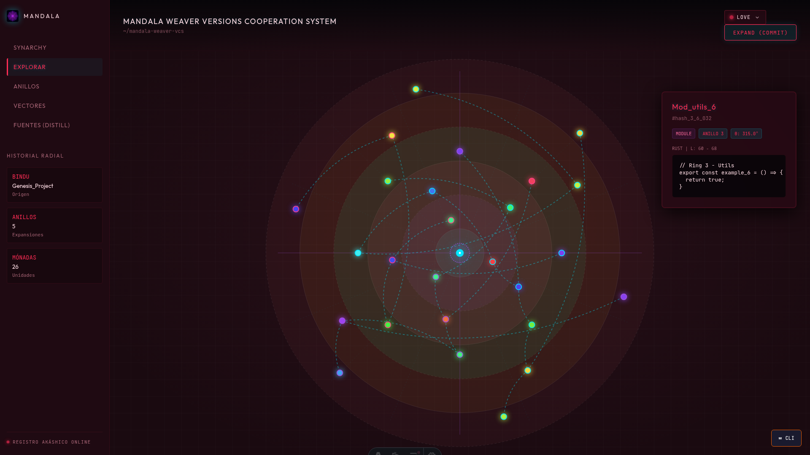
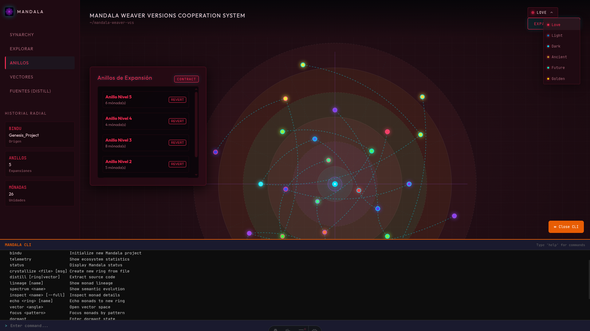
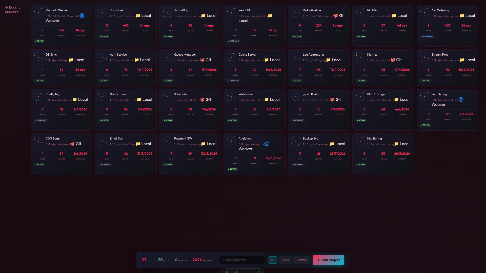

# Mandala Weaver: Versions Cooperation System
> **The Circular Time of Software.** A Synarchic, Spatial, and Semantic Code Orchestrator.

Mandala Weaver is the exact execution of the Golden Thread Engine instantiated in software architecture. It embraces a **Radial Version Space** where code is organized in living, circular geometry. Software emanates as pure, distilled logic units from an immutable center (the **Bindu**) and expands through concentric rings of evolution.

This topology enables non-linear code orchestration: the Architect selects precise spatial coordinates across various rings and vectors, weaving them into a harmonious, executable reality. The result is the **Distillation** of a unique Source—an infinite spiral of innovation where code expands outward with mathematical purity and structural harmony.




---

## Logo


---

## 🌟 Propuesta de Valor (Value Proposition)

Mandala Weaver VCS fundamenta el desarrollo, navegación y síntesis del software sobre principios de geometría radial, análisis sintáctico profundo y persistencia en grafo. Sus fortalezas y capacidades distintivas son:

### 1. Granularidad Atómica y Pureza Semántica (Mónadas AST)
- **Aislamiento de Lógica Pura:** El sistema descompone el código fuente en unidades atómicas funcionales (funciones, estructuras, enumeraciones, traits, métodos) mediante análisis sintáctico profundo con [`ast-grep`](https://ast-grep.github.io/).
- **Invarianza Estilística:** Variaciones cosméticas de espaciado, formateo, comentarios o indentación son transparentes. La identidad de cada Mónada está ligada a su verdadera estructura sintáctica, garantizando un registro limpio y libre de ruido.

### 2. Sinestesia Cromática Inmediata (blake3 $\to$ HSL)
- **Frecuencia Visual Determinista:** Cada Mónada proyecta su hash criptográfico semántico (`blake3`) directamente al espacio de color HSL (Hue, Saturation, Lightness).
- **Validación Cognitiva Instantánea:** La percepción humana valida la estabilidad del código en microsegundos: si la lógica se mantiene invariante, su color permanece matemáticamente idéntico; si la lógica muta, su frecuencia cromática se desplaza de forma visible.

### 3. Topología Espacial Radial y Tiempo Circular ($r, \theta$)
- **Geometría Viviente del Software:** Los dominios funcionales (Núcleo, Interfaz, E/S, Datos, Red) se proyectan como Ángulos ($\theta$), mientras que las iteraciones y grados de madurez se expanden hacia afuera como Radios ($r$).
- **Tiempo Acumulativo No Destructivo:** La historia del código reside intacta en los anillos concéntricos interiores. El pasado no desaparece ni se degrada: permanece accesible, analizable y reutilizable en cualquier momento para alimentar nuevas creaciones.

### 4. Destilación Declarativa y Ensamblado Modular (Manifiestos YAML)
- **Composición de Fuentes a la Carta:** Posibilidad de compilar ejecutables y árboles de código seleccionando coordenadas y rangos específicos de Mónadas a lo largo de diversos anillos y vectores.
- **Recetas de Ensamblaje Reproducibles:** Manifiestos declarativos YAML que gestionan selección por rangos, exclusión selectiva, sustitución de variables y adaptadores semánticos automáticos para enlazar componentes entre anillos.

### 5. Simbiosis Nativa con Inteligencia Artificial (Model Context Protocol - MCP)
- **Servidor MCP de Primera Clase:** Servidor integrado (`weave mcp`) sobre `stdio` / JSON-RPC con 10 herramientas semánticas y recursos en vivo (`mandala://topology`, `mandala://rings`).
- **Comprensión Holística para Modelos:** Permite a agentes autónomos (Claude, Cursor, Antigravity, Cline) consultar topología, inspeccionar árboles de sintaxis, trazar linajes evolutivos y destilar código sin sobrecargar su ventana de contexto.

### 6. Registro Akáshico en Grafo Local y Robusto (SurrealDB + SurrealKV)
- **Memoria Histórica Embebida:** Base de datos de grafos embebida con almacenamiento persistente en disco en `.mandala/db/` (motor SurrealKV) y modo en memoria ultrarrápido para entornos de prueba.
- **Trazabilidad Evolutiva Completa:** Mapeo de relaciones (`evolves_to`), indexación compuesta multidimensional, inserciones masivas en lote (`insert_batch`) y recuperación paginada de alto rendimiento para miles de nodos.

### 7. Escaneo Automático y Registro de Ecosistemas (Synarchy)
- **Flujo Dual de Ingesta:**
  - **🌀 Mandala Scan (Nativo):** Escaneo directo y políglota de árboles de archivos (soporte para más de 30 formatos: `rs, ts, tsx, js, jsx, py, go, java, c, cpp, cs, html, css, scss, vue, svelte, astro, json, yaml, md`). Opera de forma independiente sobre cualquier carpeta **sin requerir Git**, sintetizando automáticamente Mónadas de tipo `Module` para archivos estructurales y asegurando que ningún proyecto quede con 0 nodos.
  - **🐙 Git Scan:** Importación directa de repositorios Git, traduciendo árboles de trabajo y secuencias históricas a anillos concéntricos evolutivos.
- **Filotaxis Áurea y Bandas Galácticas Multi-Carril:** Distribución angular basada en el Ángulo Áureo ($137.5^\circ$) y micro-órbitas concéntricas escalonadas en anillos de alta densidad (>60 nodos), garantizando separación perfecta, legibilidad visual y cero colisiones incluso con cientos o miles de mónadas.

### 8. Experiencia Dual: Lienzo Visual Acelerado y Suite Terminal CLI/TUI
- **Navegación Visual Fractal:** Interfaz gráfica interactiva con aceleración por hardware (Tauri + React + D3.js) con respiración semántica (macro-orquestación de galaxias de código y micro-inmersión en el AST de cada nodo).
- **Control Total por Consola:** Suite completa de comandos de terminal (`weave`) e interfaz interactiva TUI para flujos de trabajo ágiles en entornos de servidor y consola.

---

## Core Concepts

**The Golden Thread of Code**
- **Monads (Pure Logic Units):** Mandala Weaver isolates and versions atomic logic (functions, structs, traits) using Abstract Syntax Tree analysis ([`ast-grep`](https://ast-grep.github.io/)). It captures the absolute essence of the code by filtering out formatting and whitespace, ensuring semantic purity.
- **Chromatic Synesthesia:** Every Monad possesses a unique visual frequency. Its color is a direct projection of its `blake3` semantic hash mapped to the HSL color space. The visual cortex instantly validates the truth of the logic: if the atomic logic mutates, the hue shifts; if the structure remains invariant, the color is immutable.
- **Vectors and Rings (Spatial Topology):** Software is organized as living geometry. Logical domains (e.g., UI, Network, Core Logic, Data) are assigned specific Angles ($\theta$), while temporal iterations and evolutionary stages expand outward as Radii ($r$).
- **Synarchic Weaving:** Features and logical units coexist in geometric space. Collaboration is a harmonious weaving of nodes drawn together by gravity and resonance. The architecture allows simultaneous evolution of components in complete synarchy, ensuring the network operates without interference.
- **Distillation (Spatial Consolidation):** The architectural process of compiling an executable version. The Architect selects exact coordinates across various rings and vectors, consolidating a unique Source by weaving independent functional capabilities into a unified structure.
- **Manifests of Cooperation (YAML):** Declarative templates that define assembly recipes. These manifests automate node selection, establish resonant compatibility, and inject semantic adapters to ensure absolute harmony between components operating in different rings.
- **The Breathing of the Mandala (Semantic Zoom and Fractality):** Navigation in radial space is an act of biological respiration alongside the system. The system breathes with the Architect in two directions:
  - **Macro-Orchestration (Zoom Out):** Expanding the perspective reveals the entire ecosystem. Individual nodes yield to the macro-structure, illuminating dependency galaxies, the density of evolutionary rings, and the global health of the synarchy at a single glance.
  - **Micro-Immersion (Focused Zoom In):** Selecting a Monad and pulling the perspective allows the Architect to traverse the node's membrane. The Monad undergoes a fractal unfolding—revealing its internal universe, its Abstract Syntax Tree (AST), its evolutionary lineage, and its atomic essence. It is a fluid transition from stellar orbit to quantum microsurgery.

---

## Model Context Protocol (MCP) Integration

Mandala Weaver VCS includes a built-in, first-class **Model Context Protocol (MCP)** server over standard input/output (`stdio`), designed for AI coding agents and developer environments (such as Claude Desktop, Cursor, Antigravity, and Cline).

### Starting the MCP Server
```bash
# Using the weave CLI
weave mcp

# Or directly through cargo
cargo run --manifest-path src-tauri/Cargo.toml -- mcp
```

### Exposed Tools

| Tool | Parameters | Description |
|---|---|---|
| `mandala_telemetry` | `verbose?: bool` | Scans project topology, ring counts, active and invariant monads. |
| `mandala_bindu` | `project_name?: string` | Instantiates Point Zero (0, 0) / project genesis. |
| `mandala_crystallize` | `file?: string, message?: string` | Radial commit: extracts AST monads from source code and expands a new ring. |
| `mandala_distill` | `monad_ids?: string[], template_path?: string, output_path?: string` | Compiles executable source code from selected monads or a YAML template. |
| `mandala_focus` | `monad_id: string` | Deep inspection of a monad's AST, raw logic, line coordinates, and hash. |
| `mandala_lineage` | `monad_id?: string, limit?: number` | Traces bidirectional evolutionary lineage through inner and outer rings. |
| `mandala_spectrum` | `monad_id: string` | Chromatic analysis of semantic mutations using BLAKE3 and HSL projection. |
| `mandala_scan_project` | `path: string` | Recursively scans and indexes a polyglot codebase into radial rings. |
| `mandala_git_import` | `repo_path: string` | Chronologically imports repository commit history into concentric rings. |
| `mandala_validate_template` | `content: string` | Validates declarative YAML distillation templates and checks syntax. |

### Live Resources & Prompts
- **`mandala://topology`**: Dynamic JSON graph of the entire mandala state (rings, monads, constellations, and edges).
- **`mandala://rings`**: Detailed breakdown of concentric rings, radius tiers, and monad distribution.
- **`architect_guidance` Prompt**: Interactive architectural instructions for AI assistants guiding circular software evolution.

### AI Agent Configuration (`claude_desktop_config.json` / Cursor)

```json
{
  "mcpServers": {
    "mandala-weaver": {
      "command": "cargo",
      "args": [
        "run",
        "--manifest-path",
        "Mandala-Weaver-VCS/src-tauri/Cargo.toml",
        "--",
        "mcp"
      ]
    }
  }
}
```

For more details, see [mcp/README.md](./mcp/README.md).

---

## Declarative Distillation Manifests (YAML Templates)

Mandala Weaver allows assembling customized source trees using declarative YAML manifests. The distillation engine traverses selected rings and vectors, filters excluded components, applies semantic adapters, and writes the assembled code to disk.

### Sample Manifest: `templates/full-stack.yaml`

```yaml
name: "full-stack"
version: "0.1.0"

rings:
  type: "Range"
  min: 1
  max: 10

vectors:
  - name: "CORE"
  - name: "UI"
  - name: "IO"
  - name: "DATA"

exclude:
  - kind: "test"
  - name: "benchmark_*"

adapters:
  - name: "std_import"
    from: "std::*"
    to: "std"
    adapter_type:
      Import:
        module: "std"

output:
  filename: "src"
  structure:
    type: "Nested"
    rings: false
    vectors: true
  generate_modules: true
```

### Template Features
- **Flexible Ring Selectors:** `All`, `Exact(u32)`, `Range { min, max }`, `UpTo(u32)`.
- **Vector Filtering:** Specific domain inclusion (`CORE`, `UI`, `IO`, `DATA`, `NETWORK`).
- **Semantic Adapters:** Automated `Import`, `Reexport`, `Wrap`, and `Custom` transformations.
- **Variable Substitution:** Dynamic interpolation of `{{variable}}` placeholders at compilation time.
- **Interactive UI Editor:** Integrated [`TemplateEditor.tsx`](./src/components/panels/TemplateEditor.tsx) in the desktop interface for creating and testing templates.

---

## Commands of Cooperation (CLI Suite)

Mandala Weaver provides the `weave` command-line tool for terminal-based workflows:

### Genesis & State
- **`weave bindu`**: Instantiates Point Zero (0, 0). Creates the core geometric seed from which all future rings and vectors will emanate.
- **`weave seed <source>`**: Plants the *Bindu* of an existing repository to begin a new fractal expansion in your local environment.
- **`weave telemetry [--verbose]`**: Scans the current topology. Returns the pulse of the local ecosystem, displaying active and invariant monads.
- **`weave status [--verbose]`**: Displays project status, active ring count, indexed monads, and storage engine health.

### Cultivation & Expansion
- **`weave focus <monad>`**: Brings specified monads into the active constellation for inspection and preparation.
- **`weave crystallize [-m "<intent>"] [file]`**: Locks the AST and generates the `blake3` semantic hash. Expands the radius ($r + 1$) to immortalize the current logic in a new evolutionary Ring.
- **`weave scan [path]`**: Recursively scans and indexes a codebase into radial rings with phyllotaxis dispersion.
- **`weave vector <angle>`**: Opens a new Angle ($\theta$) of exploration for domain development.
- **`weave dormant`**: Puts active uncrystallized Monads into the latent space (*Vórtice de Reposo*).
- **`weave inspect <monad_id> [--full]`**: Deep terminal inspection of a monad's AST, raw logic, and spatial coordinates.

### Spatial Navigation & Assembly
- **`weave distill [coordinates] [-r <ring>] [-v <vector>] [-t <template.yaml>] [-o <output_path>]`**: Compiles an executable source by harvesting monads across rings and vectors.
- **`weave spectrum <monad>`**: Analyzes chromatic shift between rings, displaying semantic variance based on HSL signatures.
- **`weave lineage [-m <monad>] [-l <limit>]`**: Queries the embedded Akashic Record to trace the evolutionary lineage of a Monad or Vector.
- **`weave echo <ring_id> [-m <monad>]`**: Retrieves the semantic resonance of a Monad from an inner Ring and weaves it into the current Ring.

### AI & Synarchy Network
- **`weave mcp`**: Runs the Model Context Protocol stdio server for AI coding assistants.
- **`weave absorb [--remote <url>]`**: Integrates crystallized nodes from the macro-ecosystem into the local environment.
- **`weave synthesize <vector> [--with-vector <vector>]`**: Finds harmonic geometry between two evolving vectors and reconciles AST alignments.
- **`weave emanate [--remote <url>]`**: Propagates local crystallized updates outward to the synarchy network.
- **`weave audit`**: Runs topological validation, verifying integrity, invariants, and collision boundaries.

---

## Technology Stack

The Loom is built on three high-performance engineering pillars:

- **The Engine (Backend):** Rust + [`nalgebra`](https://crates.io/crates/nalgebra) (Orbital and spatial math) + [`ast-grep`](https://ast-grep.github.io/) (Semantic AST parsing) + [`tokio`](https://tokio.rs/) (Async runtime) + [`blake3`](https://crates.io/crates/blake3) (Cryptographic hashing).
- **The Akashic Record (Persistence):** SurrealDB 3.0 embedded graph database. Operates with local persistent disk storage in `.mandala/db/` via SurrealKV ([`FileBridge`](./src-tauri/src/persistence/file_bridge.rs)) or in-memory mode for unit tests. Includes composite indexing, batch insertions (`insert_batch`), and paginated retrieval (`get_monads_paginated`).
- **The Canvas (UI):** Tauri 2.0 + Astro + React + D3.js (Hardware-accelerated radial visualization). Features a neo-metric dark glassmorphism aesthetic with glowing monads, polar grids, dynamic stats panels, and an integrated real-time code inspector.

---

## Architectural Philosophy

Mandala Weaver organizes software around sacred, radial geometry:

1. **The Bindu (The Center):** Every project originates from a central seed, a pure purpose at coordinate (0, 0).
2. **The Vectors (Angles - $\theta$):** Represent functional domains. For example, 0° is Core, 90° is UI, 180° is I/O, and 270° is Network.
3. **The Rings (Radii - $r$):** Represent temporal iterations, refactorings, and abstraction layers. As radius increases, code expands outward into higher maturity and integration.

### The Monad (The Functional Unit)
Mandala isolates and registers **Pure Logical Units (Monads)**: specific functions, structs, traits, and types, each positioned at an exact spatial coordinate on the circumference of a temporal ring.

### The Constellation (The Environment)
Monads residing in the same Ring that interact with each other form a Constellation, representing a stable and harmonious state of the system at that degree of expansion.

### The Source (The Consolidated Executable)
Compiling a **Source** means tracing a geometric polygon that selectively harvests Monads from across different Rings and Vectors. For example, a high-throughput network engine from Ring 2 can be harmoniously woven with modern UI components from Ring 5, synthesizing a custom, cohesive executable.

---

## Project Structure Overview

```
Mandala-Weaver-VCS/
├── src-tauri/                              # Rust Backend (Tauri & Core Engine)
│   └── src/
│       ├── main.rs                        # Entry point: Tauri app setup & CLI router
│       ├── lib.rs                         # Library exports & module definitions
│       │
│       ├── geometry/                      # Topological Engine (Polar Coordinates)
│       │   ├── mod.rs                     # Module exports
│       │   ├── polar_space.rs             # Polar coordinates (r, theta) calculation
│       │   ├── transform.rs               # Polar <-> Cartesian conversion (nalgebra)
│       │   ├── collision.rs               # Overlap detection & orbital shifting
│       │   ├── ring.rs                    # Concentric ring boundaries & scaling
│       │   └── vector.rs                  # Angular domain mapping & snap logic
│       │
│       ├── ontology/                      # System Entities & Domain Models
│       │   ├── mod.rs                     # Module exports
│       │   ├── monad.rs                   # Pure functional unit (AST-based)
│       │   ├── bindu.rs                   # Immutable project center (Point Zero)
│       │   ├── constellation.rs           # Group of harmonic monads in a ring
│       │   └── semantic_hash.rs           # Deterministic AST hashing (blake3)
│       │
│       ├── weaver/                        # The Loom (Expansion & Assembly Engine)
│       │   ├── mod.rs                     # Radial expansion (commit) logic
│       │   ├── ast_extractor.rs           # Polyglot AST extraction (ast-grep)
│       │   ├── threader.rs                # Evolutionary graph lineage queries
│       │   ├── resolver.rs                # Delta detection between rings
│       │   ├── source_compiler.rs         # Source assembler & distillation
│       │   ├── auto_imports.rs            # Dependency analyzer
│       │   ├── file_writer.rs             # Disk writing for distilled sources
│       │   └── watcher.rs                 # Live filesystem watcher
│       │
│       ├── template/                      # Declarative Distillation System
│       │   ├── mod.rs                     # Module exports & serde deserializers
│       │   ├── engine.rs                  # Distillation execution & variable substitution
│       │   ├── schema.rs                  # YAML template definitions & selectors
│       │   ├── loader.rs                  # File-system template loading & caching
│       │   ├── validator.rs               # Template syntax & reference validation
│       │   └── ast_adapter.rs             # Code transformations & module synthesis
│       │
│       ├── persistence/                   # The Akashic Record (SurrealDB Engine)
│       │   ├── mod.rs                     # Module exports
│       │   ├── schemas.rs                 # SurrealQL schemas & composite indexes
│       │   ├── surreal_bridge.rs          # Embedded SurrealDB bridge & queries
│       │   ├── file_bridge.rs             # Persistent storage (.mandala/db/ SurrealKV)
│       │   └── migration.rs               # Database migrations & upgrades
│       │
│       ├── synarchy/                      # Multi-Project Management & Ecosystem
│       │   ├── mod.rs                     # Module exports
│       │   ├── registry.rs                # Project registry & automated scanner
│       │   └── sync.rs                    # Auto-scan & background synchronizer
│       │
│       ├── collaboration/                 # Historical Ingestion & Distributed Sync
│       │   ├── mod.rs                     # Module exports & Git history import
│       │   ├── git_bridge.rs              # Non-destructive Git history extraction
│       │   └── sync.rs                    # Archive export & import
│       │
│       ├── interface/                     # IPC Handlers, CLI & Protocols
│       │   ├── mod.rs                     # Module exports
│       │   ├── projection_api.rs          # Tauri commands for Mandala workspace
│       │   ├── synarchy_api.rs            # Tauri commands for Project Explorer
│       │   ├── template_api.rs            # Tauri commands for YAML templates
│       │   ├── collaboration_api.rs       # Tauri commands for Git & archives
│       │   ├── cli_api.rs                 # IPC bridge for CLI commands
│       │   ├── cli_commands.rs            # Clap CLI parser & command implementations
│       │   ├── mcp.rs                     # Model Context Protocol (stdio JSON-RPC)
│       │   └── radial_tui.rs              # Terminal User Interface
│       │
│       └── Cargo.toml                     # Rust dependencies
│
├── src/                                   # Frontend (Astro + React + D3.js)
│   ├── pages/
│   │   ├── index.astro                    # Main Mandala Canvas workspace
│   │   ├── explorer.astro                 # Synarchy Explorer (Project list)
│   │   └── project/index.astro            # Project detail view & inspector
│   │
│   ├── layouts/
│   │   └── AppLayout.astro                # Common layout wrapper & navigation
│   │
│   ├── components/
│   │   ├── mandala/                       # Interactive Canvas (D3 + React)
│   │   │   ├── MandalaCanvas.tsx          # Radial SVG rendering & zoom engine
│   │   │   └── TooltipNode.tsx            # Floating monad details & inspector
│   │   │
│   │   ├── synarchy/                      # Project Management Components
│   │   │   ├── ProjectList.tsx            # Grid of active projects
│   │   │   ├── ProjectCard.tsx            # Mini-mandala SVG preview
│   │   │   ├── AddProject.tsx             # New project creation dialog
│   │   │   └── ProjectDetail.tsx          # Project statistics & scanner view
│   │   │
│   │   ├── panels/                        # Cooperation Control Panels
│   │   │   ├── SidebarNav.tsx             # Navigation & view mode switcher
│   │   │   ├── MonadInspector.tsx         # AST inspection & source viewer
│   │   │   ├── DistillPanel.tsx           # Tabbed Distill & Template Editor panel
│   │   │   ├── TemplateEditor.tsx         # YAML template builder & validator
│   │   │   ├── RingsPanel.tsx             # Concentric ring management & controls
│   │   │   ├── VectorsPanel.tsx           # Domain vector & angular inspection
│   │   │   └── TerminalPanel.tsx          # Integrated interactive CLI terminal
│   │   │
│   │   └── ui/                            # Reusable UI primitives
│   │
│   ├── lib/
│   │   ├── tauri/                         # Backend Communication
│   │   │   ├── commands.ts                # Workspace & Distill IPC commands
│   │   │   ├── synarchy_api.ts            # Synarchy project management IPC
│   │   │   └── events.ts                  # Real-time event listeners
│   │   │
│   │   ├── d3/                            # Visualization Algorithms
│   │   │   ├── renderer.ts                # Polar grid & monad node rendering
│   │   │   ├── links.ts                   # Evolutionary bezier curves
│   │   │   ├── interactions.ts            # Zoom, pan, lasso selection
│   │   │   └── animations.ts              # Kinetic breathing animations
│   │   │
│   │   └── state/                         # Reactive State (Zustand)
│   │       └── workspaceStore.ts          # Centralized store for topology & selections
│   │
│   ├── types/                             # TypeScript definitions
│   └── styles/                            # Neo-metric glassmorphism styles
│
├── templates/                             # Pre-packaged YAML Distillation Manifests
│   ├── full-stack.yaml                    # Full-stack multi-vector assembly template
│   └── backend-api.yaml                   # Core + IO backend service assembly template
│
├── mcp/                                   # MCP Documentation & Manifests
│   └── README.md                          # MCP configuration & integration guide
│
├── Roadmap.md                             # 10-Phase Engineering Roadmap
├── Architecture.md                        # Architectural specification
└── package.json                           # Root dependencies
```

---

## Complete Tauri IPC Command Reference

The Tauri backend provides comprehensive IPC commands accessible from the frontend:

| Category | Command | Description | Return Type |
|---|---|---|---|
| **Workspace & Topology** | [`export_mandala_state`](./src-tauri/src/interface/projection_api.rs) | Returns full mandala state (bindu, constellations, edges) as JSON | `Promise<string>` |
| | [`export_mandala_state_paginated`](./src-tauri/src/interface/projection_api.rs) | Returns paginated mandala state for large-scale graphs | `Promise<string>` |
| | [`expand_ring`](./src-tauri/src/interface/projection_api.rs) | Expands a new ring by extracting monads from a source file | `Promise<u32>` |
| | [`init_project`](./src-tauri/src/interface/projection_api.rs) | Initializes a new project Point Zero (Bindu) | `Promise<string>` |
| | [`open_project`](./src-tauri/src/interface/projection_api.rs) | Switches database context to specified project path | `Promise<string>` |
| | [`distill_from_selection`](./src-tauri/src/interface/projection_api.rs) | Compiles source code from a list of selected monad IDs | `Promise<string>` |
| | [`write_distilled_to_disk`](./src-tauri/src/interface/projection_api.rs) | Writes compiled distillation output to filesystem | `Promise<string>` |
| | [`trace_monad_lineage`](./src-tauri/src/interface/projection_api.rs) | Returns evolutionary graph lineage of a monad | `Promise<string>` |
| | [`get_monad_detail`](./src-tauri/src/interface/projection_api.rs) | Retrieves full AST, code content, and coordinates of a monad | `Promise<string>` |
| | [`contract_outer_ring`](./src-tauri/src/interface/projection_api.rs) | Rolls back the outermost ring and archives its monads | `Promise<u32>` |
| | [`revert_to_level`](./src-tauri/src/interface/projection_api.rs) | Reverts project topology to a specified ring level | `Promise<u32>` |
| | [`search_monads`](./src-tauri/src/interface/projection_api.rs) | Searches monads by name, kind, or content substring | `Promise<string>` |
| | [`get_monads_paginated_api`](./src-tauri/src/interface/projection_api.rs) | Paginated monad retrieval for efficient high-volume rendering | `Promise<string>` |
| **YAML Templates** | [`list_templates`](./src-tauri/src/interface/template_api.rs) | Lists all available YAML templates in `.mandala/templates` & defaults | `Promise<string>` |
| | [`distill_from_template`](./src-tauri/src/interface/template_api.rs) | Executes distillation based on a template file path | `Promise<string>` |
| | [`distill_from_template_content`](./src-tauri/src/interface/template_api.rs) | Executes distillation directly from raw YAML content | `Promise<string>` |
| | [`validate_template`](./src-tauri/src/interface/template_api.rs) | Validates a template file on disk | `Promise<string>` |
| | [`validate_template_content`](./src-tauri/src/interface/template_api.rs) | Validates raw YAML template syntax in memory | `Promise<string>` |
| | [`create_template`](./src-tauri/src/interface/template_api.rs) | Saves a new YAML template to the project template library | `Promise<string>` |
| | [`distill_and_write`](./src-tauri/src/interface/template_api.rs) | Distills from template and writes directly to target directory | `Promise<string>` |
| **Synarchy Ecosystem** | [`get_projects`](./src-tauri/src/interface/synarchy_api.rs) | Retrieves list of all registered projects in the synarchy registry | `Promise<string>` |
| | [`add_project`](./src-tauri/src/interface/synarchy_api.rs) | Registers and scans a new project path | `Promise<string>` |
| | [`remove_project`](./src-tauri/src/interface/synarchy_api.rs) | Unregisters a project from the synarchy registry | `Promise<string>` |
| | [`get_project_detail`](./src-tauri/src/interface/synarchy_api.rs) | Retrieves detailed metadata, rings, and stats for a project | `Promise<string>` |
| | [`rescan_project`](./src-tauri/src/interface/synarchy_api.rs) | Triggers automated re-scan and AST indexing for a project | `Promise<string>` |
| | [`get_project_mandala`](./src-tauri/src/interface/synarchy_api.rs) | Fetches the full mandala state of a specific project | `Promise<string>` |
| **Ingestion & Sync** | [`import_git_repository`](./src-tauri/src/interface/collaboration_api.rs) | Imports sequential commit history into concentric rings | `Promise<string>` |
| | [`export_mandala_archive`](./src-tauri/src/interface/collaboration_api.rs) | Exports a portable compressed archive of the project mandala | `Promise<string>` |
| | [`import_mandala_archive`](./src-tauri/src/interface/collaboration_api.rs) | Imports a project archive into local storage | `Promise<string>` |
| | [`sync_project`](./src-tauri/src/interface/collaboration_api.rs) | Synchronizes project with remote synarchy peers | `Promise<string>` |
| **CLI Proxies** | `cli_bindu`, `cli_telemetry`, `cli_status`, `cli_crystallize`, `cli_distill`, `cli_lineage`, `cli_spectrum`, `cli_inspect`, `cli_echo`, `cli_vector`, `cli_focus`, `cli_dormant`, `cli_synthesize`, `cli_absorb`, `cli_emanate`, `cli_seed` | Direct terminal execution proxies for the integrated GUI terminal panel | `Promise<string>` |

---

## Data Flow Architecture

```
+-----------------------------------------------------------------------------------------+
|                                    ARCHITECT / USER                                     |
|    +--------------------+    +--------------------+    +---------------------------+    |
|    | Visual Canvas (D3) |    | Terminal CLI / TUI |    | AI Agent (MCP via stdio)  |    |
|    +---------+----------+    +---------+----------+    +-------------+-------------+    |
+--------------|-------------------------|-----------------------------|------------------+
               |                         |                             |
               V                         V                             V
+-----------------------------------------------------------------------------------------+
|                                 APPLICATION INTERFACE                                   |
|                                                                                         |
|  +-----------------------------------+        +--------------------------------------+  |
|  |     Tauri 2.0 IPC Layer           |        |      Model Context Protocol (MCP)    |  |
|  |  (30+ Commands & Event Streams)   |        |   (10 Tools, Resources & Prompts)    |  |
|  +-----------------+-----------------+        +------------------+-------------------+  |
+--------------------|---------------------------------------------|----------------------+
                     |                                             |
                     +----------------------+----------------------+
                                            |
                                            V
+-----------------------------------------------------------------------------------------+
|                                  MANDALA CORE ENGINE                                    |
|                                                                                         |
|  +-----------------------------------+        +--------------------------------------+  |
|  |     Geometry & Polar Space        |        |      Weaver & AST Parser             |  |
|  |  - PolarCoord (r, theta)          |        |  - ast-grep Polyglot Parser          |  |
|  |  - Collision resolution           |        |  - blake3 Semantic Hashing           |  |
|  |  - nalgebra orbital projection    |        |  - Delta Resolver & Source Compiler  |  |
|  +-----------------+-----------------+        +------------------+-------------------+  |
|                    |                                             |                      |
|                    +----------------------+----------------------+                      |
|                                           |                                             |
|  +----------------------------------------+------------------------------------------+  |
|  |     Declarative Distillation Engine (YAML Manifests)                              |  |
|  |  - Range/Exact Ring Selectors  - Semantic Adapters  - Variable Substitution        |  |
|  +----------------------------------------+------------------------------------------+  |
+-------------------------------------------|---------------------------------------------+
                                            |
                                            V
+-----------------------------------------------------------------------------------------+
|                         THE AKASHIC RECORD (Persistence Layer)                          |
|                                                                                         |
|  +-----------------------------------------------------------------------------------+  |
|  |     Embedded SurrealDB 3.0 (Graph & Relational Engine)                            |  |
|  |                                                                                   |  |
|  |  Storage Modes:                                                                   |  |
|  |  • Persistent: .mandala/db/ (SurrealKV Engine via FileBridge)                     |  |
|  |  • Ephemeral:  surrealdb://mem (In-Memory for unit tests)                         |  |
|  |                                                                                   |  |
|  |  Tables & Lineage:                                                                |  |
|  |  • monad (id, name, content, ring, coord {r, theta}, kind, semantic_hash)        |  |
|  |  • evolves_to (Graph Relation: monad -> monad)                                    |  |
|  |  • bindu (project_name, timestamp)                                                |  |
|  |  • operation_log (op_type, monad_id, timestamp, payload)                          |  |
|  |                                                                                   |  |
|  |  Optimization & Performance:                                                      |  |
|  |  • Composite Indexes: (ring, theta), (name, ring), (semantic_hash)                |  |
|  |  • High-Throughput Batch Ingestion: insert_batch()                                |  |
|  |  • Scalable Pagination: get_monads_paginated()                                     |  |
|  +-----------------------------------------------------------------------------------+  |
+-----------------------------------------------------------------------------------------+
```

---

## Essential Commands

### Development (Desktop Application)
Starts the Vite dev server and compiles the Rust backend, opening the native Tauri window with Hot Module Replacement (HMR):
```bash
pnpm run tauri dev
```

### Core Engine Tests (Backend Rust)
Runs all unit and integration tests for geometric math, AST parsing, YAML distillation, persistence, and MCP tools:
```bash
cd src-tauri
cargo test
cargo check
```

### Running the MCP Server
Launches the stdio JSON-RPC server for integration with AI coding assistants:
```bash
cargo run --manifest-path src-tauri/Cargo.toml -- mcp
```

### Web Frontend Preview
Runs the Astro frontend independently in a standard browser (for visual CSS and layout tuning):
```bash
pnpm run dev
```

### Production Build
Generates optimized, self-contained binaries and installers (`.exe` on Windows, `.app` on macOS, `.AppImage` on Linux):
```bash
pnpm run tauri build
```

---

## Roadmap

For the detailed 10-phase engineering roadmap—including completed core engines, YAML templates, MCP server, performance scaling, and distributed synarchy networks—see **[Roadmap.md](./Roadmap.md)**.

---

*Software is cultivated from the center outward.*
