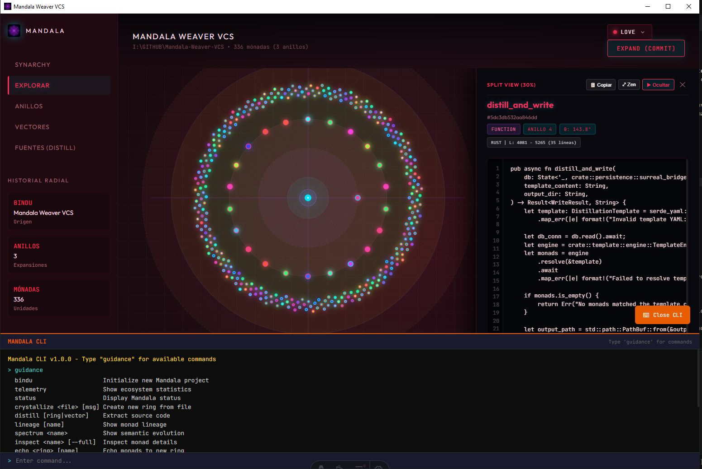
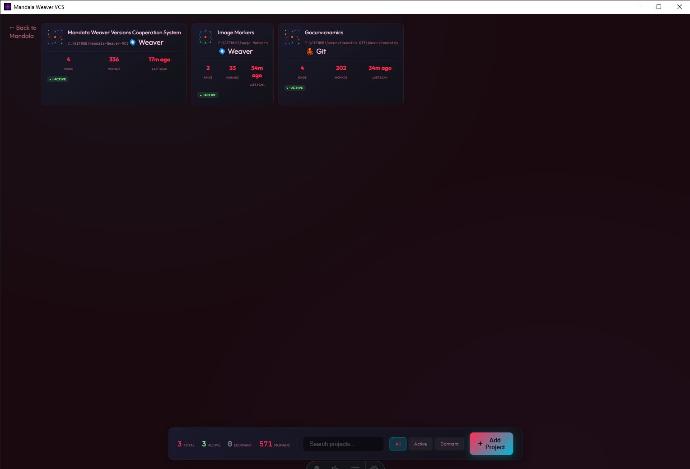

# 🌀 Mandala Weaver: Versions Cooperation System (VCS)

> **El Tiempo Circular del Software.** Un Orquestador de Código Espacial, Semántico y Sinárquico.

Mandala Weaver es la materialización en arquitectura de software del **Motor del Hilo Dorado**. Abraza un **Espacio de Versionado Radial** donde el código se organiza en una geometría viviente y circular. El software no evoluciona como una lista lineal de commits en ramas conflictivas, sino como unidades de lógica pura emanadas desde un centro inmutable (el **Bindu**) hacia anillos concéntricos de expansión continua.

Esta topología habilita la orquestación no lineal del software: el Arquitecto selecciona coordenadas espaciales precisas a través de diversos anillos y vectores, tejiéndolas en una realidad ejecutable armónica. El resultado es la **Destilación** de una Fuente única: una espiral de innovación continua donde el código se expande con pureza matemática y coherencia estructural.

---

## 📸 Interfaz de Usuario

### 🧭 Lienzo Radial Principal (Mandala Canvas & Split View Zen)


### 🪐 Explorador Sinárquico Multi-Proyecto (Synarchy Explorer)


### 💠 Emblema del Sistema


---

## 🌟 Las 12 Propuestas de Valor Fundamentales

Mandala Weaver VCS redefine el desarrollo, navegación y síntesis del software sobre principios de geometría radial, análisis sintáctico profundo y persistencia en grafo:

### 1. Granularidad Atómica y Pureza Semántica (Mónadas AST)
- **Aislamiento de Lógica Pura:** Descompone el código fuente en unidades atómicas funcionales (funciones, estructuras, enumeraciones, traits, clases, interfaces, tipos) mediante análisis sintáctico profundo con [`ast-grep`](https://ast-grep.github.io/) y gramáticas Tree-sitter nativas.
- **Invarianza Estilística:** Variaciones cosméticas de espaciado, formateo, comentarios o indentación son completamente transparentes. La identidad de cada Mónada está ligada a su verdadera estructura sintáctica, garantizando un registro limpio y libre de ruido.

### 2. Sinestesia Cromática Inmediata (BLAKE3 $\to$ HSL)
- **Frecuencia Visual Determinista:** Cada Mónada proyecta su hash criptográfico semántico (`blake3`) directamente al espacio de color HSL (Hue, Saturation, Lightness).
- **Validación Cognitiva Instantánea:** La percepción humana valida la estabilidad del código en microsegundos: si la lógica se mantiene invariante, su color permanece matemáticamente idéntico; si la lógica muta, su frecuencia cromática se desplaza de forma visible.

### 3. Topología Espacial Radial y Tiempo Circular ($r, \theta$)
- **Geometría Viviente del Software:** Los dominios funcionales (Núcleo, E/S, Datos, UI, Servicios) se proyectan como Ángulos ($\theta$), mientras que las iteraciones temporales y grados de madurez se expanden hacia afuera como Radios ($r$).
- **Tiempo Acumulativo No Destructivo:** La historia del código reside intacta en los anillos concéntricos interiores. El pasado no desaparece ni se degrada: permanece accesible, analizable y reutilizable en cualquier momento para alimentar nuevas creaciones.

### 4. Destilación Declarativa y Ensamblado Modular (Manifiestos YAML & Recetas $SO(2)$)
- **Composición de Fuentes a la Carta:** Posibilidad de compilar ejecutables y árboles de código seleccionando coordenadas y rangos específicos de Mónadas a lo largo de diversos anillos y vectores.
- **Recetas de Ensamblaje Reproducibles:** Manifiestos declarativos YAML que gestionan selección por rangos, exclusión selectiva, sustitución de variables y adaptadores semánticos automáticos para enlazar componentes entre anillos.

### 5. Simbiosis Nativa con Agentes de IA (Model Context Protocol - MCP v2.0)
- **Servidor MCP de Primera Clase:** Servidor integrado (`weave mcp`) sobre `stdio` / JSON-RPC 2.0 con **17 herramientas semánticas**, **5 recursos en vivo** (`mandala://topology`, `mandala://rings`, `mandala://contracts`, etc.) y **2 prompts** arquitectónicos.
- **Comprensión Holística para Modelos:** Permite a agentes autónomos (Claude Desktop, Cursor, Antigravity, Cline, Windsurf, Gemini) consultar topología, inspeccionar árboles de sintaxis, trazar linajes evolutivos y destilar código sin sobrecargar su ventana de contexto.
- **Garantía No-Destructiva:** El código generado se retorna en memoria o se aísla en el sandbox `.mandala/distilled/` sin alterar el código fuente del proyecto.

### 6. Registro Akáshico en Grafo Local y Robusto (SurrealDB 3 + SurrealKV)
- **Memoria Histórica Embebida:** Base de datos de grafos embebida con almacenamiento persistente en disco en `.mandala/db/` (motor `SurrealKV`) y modo en memoria ultrarrápido para pruebas y sandbox.
- **Trazabilidad Evolutiva Completa:** Mapeo de relaciones (`evolves_to`), indexación compuesta multidimensional, inserciones masivas atómicas (`insert_batch`) y recuperación paginada de alto rendimiento.

### 7. Escaneo Automático y Registro de Ecosistemas (Synarchy Multi-Project)
- **Flujo Dual de Ingesta:**
  - **🌀 Mandala Scan (Nativo):** Escaneo directo y políglota de árboles de archivos (soporte nativo para 22 lenguajes). Opera sobre cualquier carpeta **sin requerir Git**, sintetizando automáticamente Mónadas de tipo `Module` y evitando proyectos vacíos.
  - **🐙 Git Scan:** Importación directa de repositorios Git, traduciendo árboles de trabajo y secuencias históricas de commits a anillos concéntricos evolutivos.
- **Filotaxis Áurea y Bandas Galácticas:** Distribución angular basada en el Ángulo Áureo ($137.5077^\circ$) y micro-órbitas concéntricas escalonadas en anillos de alta densidad, garantizando separación perfecta, legibilidad visual y cero colisiones.

### 8. Experiencia Dual: Lienzo Visual Acelerado y Suite Terminal CLI/TUI
- **Navegación Visual Fractal:** Interfaz gráfica interactiva con aceleración por hardware (Tauri v2 + Astro + React + D3.js) con respiración semántica (macro-orquestación de galaxias de código y micro-inmersión en el AST de cada nodo).
- **Control Total por Consola:** Suite completa de 18 comandos de terminal (`weave`) para flujos de trabajo ágiles en entornos de servidor, CI/CD y consola.

### 9. Hasher Merkle Canónico & Doble Dominio Ontológico (`contract_hash` e `implementation_hash`)
- **Invarianza de Formato y Comentarios:** El árbol de sintaxis de `ast-grep` se normaliza ignorando trivia, saltos de línea y comentarios, garantizando que dos códigos con distinta estética generen exactamente el mismo `implementation_hash`.
- **Invarianza de Nombres de Parámetro en Interfaz:** En lenguajes tipados, `fn procesar(x: f64) -> bool` y `fn procesar(valor: f64) -> bool` comparten el mismo contrato binario. El sistema hashea exclusivamente tipos y orden, otorgándoles un `contract_hash` idéntico y permitiendo su intercambio transparente en el anillo.
- **Detección Automática de Puertos de Salida:** Extracción en tiempo real de todas las llamadas salientes (`outbound_calls`) en el cuerpo AST, discriminando intrínsecos del lenguaje (`Ok`, `Err`, `Some`).

### 10. Grafo Tripartito Ontológico (`monad` — `contract` — `port`) y Geometría Continua en $SO(2)$
- **Direccionamiento por Contenido Puro en SurrealDB:** En lugar de documentos planos, el sistema modela un grafo tripartito:
  $$\text{monad} \xrightarrow{\text{implements}} \text{contract} \xrightarrow{\text{exposes\_port}} \text{port} \xleftarrow{\text{requires\_port}} \text{monad}$$
- **Espacio Polar Continuo en el Grupo de Rotación $SO(2)$:** Representación angular mediante `nalgebra::UnitComplex<f64>`, eliminando la discontinuidad artificial en $0 \leftrightarrow 2\pi$ y el bloqueo de cardán (*gimbal lock*) al calcular distancias geodésicas y vecindades semánticas.

### 11. Weaver Espacial con Mónadas Puente Automáticas (`@mandala-bridge`)
- **Resolución Automática de Colisión de Contratos:** Cuando un invocador requiere un contrato histórico pero el proveedor evolucionó a una firma más avanzada, SurrealDB localiza un adaptador mediante la relación `adapts_contract`.
- **Reescritor Higiénico de AST (`AstSynthesizer`):** Genera un alias determinista (`__bridge_<hash8>`) y reescribe exclusivamente los nodos `call_expression` del invocador sin colisiones de nombres en el archivo compilado.
- **Ordenación Topológica Determinista:** Algoritmo de Componentes Fuertemente Conexas de Tarjan (`tarjan_scc`) que garantiza emisión determinista de dependencias (`Proveedor -> Puente -> Invocador`) con encabezados de auditoría `@mandala-bridge`.

### 12. Split View Zen (70% Mandala | 30% Inspector) con Ocultación Dinámica
- **Modo Dividido Ergonómico:** Al seleccionar una mónada, el Mandala se ajusta al 70% de la pantalla y el 30% derecho se convierte en un visor de código Zen a altura completa (`100% vertical`) con gutter de números de línea reales.
- **Alternancia y Pantalla Completa:** Botón `▶ Ocultar Panel` para devolver el Mandala al 100% de la pantalla con una píldora flotante minimalista (`◀ Desplegar Mónada`), y botón `⤢ Zen` para expandir el código al 75% cuando se requiere concentración absoluta.

---

## 🧰 Servidor Model Context Protocol (MCP v2.0)

Mandala Weaver VCS incorpora un servidor nativo de **Model Context Protocol (MCP)** sobre `stdio` para asistentes y agentes de IA:

### Herramientas Expuestas (17 Tools)

| Herramienta | Parámetros Clave | Propósito |
|---|---|---|
| `mandala_telemetry` | `verbose?: bool` | Escanea la topología completa: anillos, lenguajes, mónadas y contratos. |
| `mandala_bindu` | `project_name: string` | Instancia el Punto Cero $(0,0)$ o génesis del proyecto. |
| `mandala_crystallize` | `file_path: string`, `message?: string` | Commit radial: extrae mónadas AST de un archivo y expande un nuevo anillo. |
| `mandala_unweave` | `path?: string` | **InnerKnow:** Shatter ontológico de monolitos a mónadas y contratos. |
| `mandala_distill_spatial` | `seeds: string[]`, `target_angle_deg?: number`, `policy?: string` | Destilación $SO(2)$ geodésica no destructiva a partir de semillas funcionales. |
| `mandala_resolve_contract` | `symbol_name: string`, `target_angle_deg?: number` | Resuelve la mónada más cercana en $SO(2)$ que implementa un contrato o puerto. |
| `mandala_search_monads` | `query: string`, `kind?: string`, `language?: string` | Búsqueda semántica por nombre, tipo, lenguaje, hash o código. |
| `mandala_audit_topology` | `ring?: number` | Audita colisiones de nombres, duplicados y coherencia de interfaces. |
| `mandala_ring_diff` | `base_ring: number`, `target_ring: number` | Compara formalmente dos anillos concéntricos ($+$, $\sim$, $-$, $=$). |
| `mandala_vectors` | `sector?: string` | Inspecciona sectores $SO(2)$ (`CORE`, `IO`, `DATA`, `UI`, `SERVICES`) y aristas. |
| `mandala_contract_ring` | `target_ring?: number` | Contrae (archiva de forma blanda) el anillo exterior sin borrar archivos de disco. |
| `mandala_distill` | `monad_ids?: string[]`, `template_content?: string` | Compila y ordena código fuente a partir de mónadas o plantillas YAML. |
| `mandala_focus` | `monad_name_or_id: string` | Inspección profunda de una mónada (AST, líneas 1-based, hash, llamadas). |
| `mandala_lineage` | `monad_id: string` | Consulta el linaje evolutivo bidireccional (`evolves_to`) de una mónada. |
| `mandala_spectrum` | `monad_name: string` | Análisis cromático de mutaciones semánticas (HSL / BLAKE3). |
| `mandala_scan_project` | `path: string`, `force_rescan?: bool` | Escaneo políglota e indexación a SurrealDB con garantía no destructiva. |
| `mandala_git_import` | `repo_path: string` | Importación cronológica del historial Git a anillos concéntricos. |
| `mandala_validate_template` | `template_yaml: string` | Valida sintáctica y semánticamente manifiestos YAML de destilación. |

### Recursos y Prompts Nativos
- **Recursos (`resources/read`):** `mandala://topology`, `mandala://rings`, `mandala://contracts`, `mandala://vectors`, `mandala://recipe`.
- **Prompts (`prompts/get`):** `architect_guidance`, `spatial_distill_prompt`.

---

## 💻 Suite CLI `weave` (18 Comandos)

Mandala Weaver incluye la herramienta de terminal `weave` para orquestación sin GUI:

```bash
# Génesis del proyecto
weave bindu

# Escaneo nativo sin Git
weave scan .

# Autoconocimiento ontológico y Grafo Tripartito
weave innerknow .

# Estado del ecosistema y anillos
weave status -v
weave telemetry --verbose

# Commit radial desde archivo modificado
weave crystallize src/lib.rs -m "Evolución del parser"

# Destilación espacial geodésica a partir de semillas
weave distill --template recipe.yaml

# Inspección de mónadas y linaje
weave inspect connect_db --full
weave lineage --monad connect_db

# Auditoría de coherencia
weave audit

# Servidor MCP sobre stdio
weave mcp
```

---

## 🌐 Extractor AST Políglota (22 Lenguajes Soportados)

El motor de análisis sintáctico `ast_extractor.rs` reconoce de manera nativa los siguientes lenguajes mediante Tree-sitter y `ast-grep-core`:

| Lenguaje | Extensiones | Nodos AST Extraídos |
|---|---|---|
| **Rust** | `.rs` | `function_item`, `struct_item`, `enum_item`, `trait_item`, `impl_item` |
| **TypeScript / TSX** | `.ts`, `.tsx`, `.mts`, `.cts` | `function_declaration`, `class_declaration`, `interface_declaration`, `type_alias_declaration`, `method_definition` |
| **JavaScript / JSX** | `.js`, `.jsx`, `.mjs`, `.cjs` | `function_declaration`, `class_declaration`, `lexical_declaration`, `method_definition` |
| **Python** | `.py` | `function_definition`, `class_definition`, `decorated_definition` |
| **Go** | `.go` | `function_declaration`, `method_declaration`, `type_declaration` |
| **Java** | `.java` | `method_declaration`, `class_declaration`, `interface_declaration` |
| **C / C++** | `.c`, `.h`, `.cpp`, `.hpp`, `.cc` | `function_definition`, `struct_specifier`, `class_specifier` |
| **C#** | `.cs` | `method_declaration`, `class_declaration`, `interface_declaration` |
| **Kotlin** | `.kt`, `.kts` | `function_declaration`, `class_declaration` |
| **Swift** | `.swift` | `function_declaration`, `class_declaration`, `protocol_declaration` |
| **Ruby** | `.rb` | `method`, `class`, `module` |
| **PHP** | `.php` | `function_definition`, `class_declaration`, `method_declaration` |
| **Scala** | `.scala` | `function_definition`, `class_definition`, `object_definition` |
| **Elixir** | `.ex`, `.exs` | `call` (`def`, `defp`, `defmodule`) |
| **Haskell** | `.hs` | `function_declaration`, `type_declaration` |
| **Lua** | `.lua` | `function_declaration`, `local_function` |
| **Dart** | `.dart` | `function_signature`, `class_definition` |
| **SQL** | `.sql` | `create_function`, `create_table`, `create_view` |
| **HTML / CSS** | `.html`, `.css`, `.scss` | Bloques estructurados de plantillas y hojas de estilo |
| **YAML / JSON** | `.yaml`, `.yml`, `.json` | Documentos y esquemas de configuración estructurales |

---

## 🛠️ Stack Tecnológico

- **Núcleo del Sistema (Core Engine):**
  - Lenguaje: Rust 2021 Edition
  - Álgebra y Rotaciones: `nalgebra 0.33` (Representación continua $SO(2)$ con `UnitComplex`)
  - Análisis Sintáctico AST: `ast-grep-core 0.42` & `ast-grep-language 0.42` (Builtin parsers)
  - Hashing Semántico: `blake3 1.5`
  - Base de Datos de Grafos: `surrealdb 3.0.5` con motor local embebido `SurrealKV` (`.mandala/db/`)
  - Serialización Declarativa: `serde_yml 0.0.12` y `serde_json 1.0`
  - CLI: `clap 4.5` con soporte de variables de entorno y derivación
- **Interfaz y Capa de Presentación:**
  - Runtime de Escritorio: `Tauri v2.0` (`tauri`, `tauri-plugin-shell`) con empaquetado activo y CSP estricto
  - Framework Web: `Astro 4.15` + `React 18.3`
  - Visualización Radial y Físicas: `D3.js 7.9` (cuadrículas polares, curvas Bézier, zoom semántico)
  - Estado del Cliente: `Zustand 4.5`
  - Estilos y Temas: CSS Moderno con variables dinámicas para modo Oscuro y Claro

---

## 📦 Instalación y Compilación

### Requisitos Previos
- **Rust:** `1.75+` (con `cargo`)
- **Node.js:** `18+`
- **pnpm:** `8+` o `9+`

### 1. Clonar e Instalar Dependencias
```bash
git clone https://github.com/tu-usuario/Mandala-Weaver-VCS.git
cd Mandala-Weaver-VCS

# Instalar dependencias del frontend
pnpm install
```

### 2. Ejecutar Pruebas Unitarias
```bash
# Ejecutar la suite completa de tests de Rust (62 pruebas)
cd src-tauri
cargo test --lib
cd ..
```

### 3. Compilar el Frontend
```bash
pnpm run build
```

### 4. Iniciar la Aplicación en Modo Desarrollo
```bash
pnpm run tauri dev
```

### 5. Compilar Binarios de Producción
```bash
pnpm run tauri build
```
Los instaladores (.msi, .exe en Windows / .dmg en macOS / .AppImage, .deb en Linux) se generarán en `src-tauri/target/release/bundle/`.

---

## 📜 Licencia

Mandala Weaver VCS está licenciado bajo la **Licencia MIT**. Siéntete libre de utilizarlo, modificarlo y tejer nuevas constelaciones de software con total libertad.
